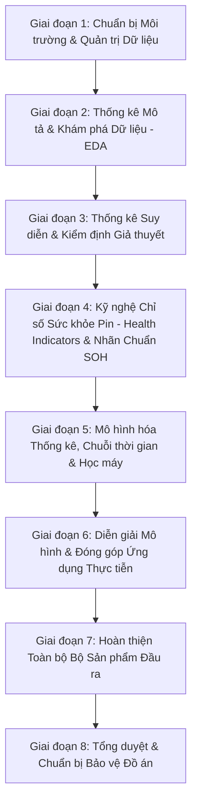

# KẾ HOẠCH TRIỂN KHAI ĐỒ ÁN MÔN PHÂN TÍCH THỐNG KÊ (STAT3013)
## Đề tài: Statistical and Machine Learning-Based Modeling of Lithium-Ion Battery Degradation and State-Of-Health Prognostics under Variable Operating Conditions
**Nhóm thực hiện:** 4AnhTai (4 thành viên)  
**Mục tiêu:** Tối đa hóa điểm số đồ án (Target: Điểm A / 9.5 - 10.0), thỏa mãn và vượt kỳ vọng toàn bộ chuẩn đầu ra học thuật của môn học.

---

## I. TỔNG QUAN ĐỀ TÀI & CHIẾN LƯỢC TỐI ĐA ĐIỂM (RUBRIC ALIGNMENT)

### 1. Thông tin tổng quan
* **Môn học:** Phân tích Thống kê (Statistical Analytics) - Mã môn: `STAT3013`.
* **Dataset sử dụng:** Kết hợp 2 bộ dữ liệu thực nghiệm chuẩn quốc tế từ NASA Ames Research Center và PML-UCF:
  1. *NASA Room Temperature Random Walk (RW) Dataset (2014):* 4 cell pin 18650 vận hành dưới chế độ dòng ngẫu nhiên phân bố đều (-4.5A đến +4.5A) và chu kỳ kiểm chuẩn SOH định kỳ.
  2. *Accelerated Life Testing (ALT) Dataset (2023):* 27+ khối pin (battery packs) phân loại theo 3 nhóm: Tải không đổi (Constant), Tải biến thiên ngẫu nhiên (Variable), Đổi nhiệm vụ (Recommissioned), và Tái sử dụng (Second-life).
* **Định hướng nghiên cứu cốt lõi:** Áp dụng toàn diện các công cụ phân tích từ **Thống kê mô tả (Descriptive)** $\to$ **Thống kê suy diễn (Inferential / Hypothesis Testing)** $\to$ **Mô hình chuỗi thời gian & Hồi quy (Time Series / Regression)** $\to$ **Học máy / Học sâu (Machine Learning / Deep Learning)** để mô hình hóa quy luật suy thoái, ước lượng trạng thái sức khỏe (State-of-Health - SOH) và dự báo tuổi thọ còn lại (Remaining Useful Life - RUL) của pin Li-ion dưới tải trọng động thực tế.

### 2. Các sản phẩm đầu ra bắt buộc (Deliverables Checklist)
Theo quy định của giảng viên trong khung đồ án STAT3013:
1. **01 Báo cáo đầy đủ (Full Report):** Dung lượng $\approx 30$ trang, cấu trúc học thuật chuẩn 8 chương (Introduction, Literature Review, Methodology, Implementation & Experiments, Results & Discussion, Conclusion & Recommendations, References, Appendix).
2. **01 Bài báo khoa học chuẩn IEEE (IEEE Conference Paper):** Dung lượng $7 - 10$ trang, định dạng 2 cột theo IEEE Template, trình bày súc tích, chuyên sâu như một công trình nghiên cứu hội nghị.
3. **Mã nguồn GitHub (GitHub Repository):** Tên repo chuẩn quy ước `STAT3013.QXX_GroupYY`, code sạch, module hóa, có notebook chạy thực nghiệm có chú thích và tài liệu README hướng dẫn reproduce 100%.
4. **Slide thuyết trình (Presentation Deck):** Slide báo cáo bảo vệ đồ án chuyên nghiệp, trực quan, cô đọng số liệu thống kê và biểu đồ kết quả.
5. **Video Demo (Demo Video):** Video ghi hình tóm tắt quy trình dự án, pipeline xử lý dữ liệu và demo chạy mô hình / dashboard trực quan hóa.
6. **Bằng chứng kiểm tra đạo văn (Plagiarism Report):** Ảnh chụp kết quả Turnitin $\le 10\%$.
7. **Bằng chứng kiểm tra nội dung do AI tạo (AI-Generation Audit):** Báo cáo kiểm định và giải trình tỷ lệ sử dụng công cụ hỗ trợ AI (Grammarly/Quillbot/ZeroGPT).

### 3. Chiến lược đạt điểm tối đa (Grade Maximization Strategy)
* **Tính chặt chẽ về mặt phương pháp luận:** Không chỉ áp dụng máy móc các thuật toán ML/DL, mà phải làm nổi bật nền tảng thống kê (kiểm định phân phối, kiểm tra giả định mô hình, kiểm định phương sai, khoảng tin cậy 95%, định lượng độ bất định - Uncertainty Quantification).
* **Ánh xạ vào bài toán kinh tế - kỹ thuật (Business & Operational Insights):** Giải thích rõ ràng ý nghĩa của SOH/RUL đối với bài toán kinh tế vận hành đội xe điện (EV Fleet Management), trạm lưu trữ năng lượng tái tạo (BESS), chiến lược bảo trì dự đoán (Predictive Maintenance) và thị trường tái sử dụng pin thứ cấp (Second-life Battery Market).
* **Tính minh bạch và khả năng tái lập (Reproducibility):** Cung cấp pipeline tự động hóa hoàn toàn từ tiền xử lý, rút trích feature, huấn luyện đến đánh giá.
* **100% thành viên nắm vững toàn bộ dự án:** Phân công theo ma trận RACI, mỗi thành viên phụ trách chính một mảng nhưng tham gia chéo và tổng duyệt (Mock Defense) để phản biện trôi chảy trước hội đồng.

### 4. Hệ thống 4 Thuật toán Trọng tâm Chuẩn SOTA (2 Statistical, 1 ML, 1 DL)
Để đảm bảo đề tài đạt điểm tối đa (chuẩn nghiên cứu công bố IEEE), đồ án loại bỏ các mô hình cơ bản lỗi thời và triển khai **hệ thống 4 thuật toán hiện đại bậc nhất**, được chọn lọc chuyên biệt để giải quyết các đặc tính phức tạp của bộ dữ liệu Pin Li-ion dưới tải ngẫu nhiên (phi tuyến tính, phục hồi dung lượng, nhiễu động học và biến định danh đa phân nhóm):

| STT | Phân nhóm | Tên Thuật toán Chuẩn SOTA | Vai trò trong Đồ án | Lý do lựa chọn & Tính tương thích với Dataset |
| :---: | :--- | :--- | :--- | :--- |
| **1** | **Statistical 1** | **Gaussian Process Regression (GPR)** với Hạt nhân Tổ hợp (*Composite Covariance Kernel: Matérn 5/2 + RQ + White Noise*) | Ước lượng SOH và dự báo suy thoái dung lượng kèm **Định lượng Độ bất định (Uncertainty Quantification)** | Là chuẩn mực vàng (Gold Standard) trong thống kê Bayes cho bài toán suy thoái pin. Cho phép xuất ra phân phối xác suất đầy đủ: giá trị kỳ vọng $\mu(x_*)$ và khoảng tin cậy 95% ($\pm 1.96\sigma$), bắt trọn hiện tượng phục hồi dung lượng (capacity regeneration) và lọc nhiễu cảm biến. |
| **2** | **Statistical 2** | **Bayesian Structural Time Series (BSTS)** (Chuỗi thời gian Cấu trúc Bayes qua State-Space & MCMC) | Dự báo xu hướng chuỗi thời gian suy thoái dung lượng tích hợp các biến ngoại sinh động (Dynamic Exogenous Regressors) | Hiện đại vượt trội so với ARIMA truyền thống: Cho phép phân rã chuỗi thời gian thành Xu hướng phi tuyến (Trend), Chu kỳ đo kiểm chuẩn (Cycle), và tác động từ các biến tải trọng ngẫu nhiên (Current, Temperature) thông qua lọc Kalman và lấy mẫu MCMC Gibbs Sampling. |
| **3** | **Machine Learning** | **CatBoost Regressor** (Categorical Gradient Boosting) | Hồi quy SOH thời gian thực từ tập đặc trưng sức khỏe gián tiếp (Health Indicators - HIs) | Thuật toán GBDT SOTA cho dữ liệu bảng/cảm biến: Cơ chế **Ordered Boosting** chống Overfitting và thuật toán xử lý biến phân nhóm độc quyền xử lý hoàn hảo dữ liệu ALT (phân biệt các nhóm pin `Constant`, `Variable`, `Recommissioned`, `Second-life`) mà không bị rò rỉ dữ liệu (Target Leakage). |
| **4** | **Deep Learning** | **Time Series Transformer Encoder (Transformer thuần cho chuỗi thời gian)** | Dự báo Tuổi thọ Còn lại (Remaining Useful Life - RUL) từ chuỗi đặc trưng vận hành đa chiều | Kiến trúc Transformer Encoder chuẩn mực (chuẩn bài báo kinh điển *Attention Is All You Need*): Sử dụng cơ chế Multi-Head Self-Attention để tự động học mối tương quan toàn cục giữa các chu kỳ sạc/xả trong quá khứ và bắt trúng "knee-point" (điểm gãy suy thoái). Cấu trúc trong sáng, thanh lịch, dễ code và cực kỳ thuận lợi khi bảo vệ đồ án. |

---

## II. LỘ TRÌNH TRIỂN KHAI CHI TIẾT (8 GIAI ĐOẠN TỪ ĐẦU ĐẾN CUỐI)



---

### GIAI ĐOẠN 1: CHUẨN BỊ MÔI TRƯỜNG, QUẢN TRỊ DỰ ÁN & TIỀN XỬ LÝ DỮ LIỆU THÔ
> **Mục tiêu:** Xây dựng cơ sở hạ tầng kỹ thuật chuẩn mực, chuyển đổi dữ liệu thô (.mat, .Rda, .csv) thành định dạng chuẩn tốc độ cao (Parquet), phân định rõ vai trò nhóm.

#### Bước 1.1: Khởi tạo Repository và Cấu trúc Thư mục Chuẩn
* Thiết lập cấu trúc repo theo chuẩn dự án Data Science chuyên nghiệp:
  ```text
  STAT3013.QXX_GroupYY/
  ├── data/
  │   ├── raw/                 # Dữ liệu gốc (.mat, .Rda, .csv)
  │   └── processed/           # Dữ liệu đã làm sạch & parquet hóa
  ├── notebooks/               # Jupyter Notebooks theo từng giai đoạn
  │   ├── 01_data_ingestion.ipynb
  │   ├── 02_eda_descriptive.ipynb
  │   ├── 03_inferential_stats.ipynb
  │   ├── 04_feature_engineering.ipynb
  │   └── 05_modeling_evaluation.ipynb
  ├── src/                     # Source code module hóa (Python package)
  │   ├── data_loader.py
  │   ├── stats_tests.py
  │   ├── feature_extraction.py
  │   └── models.py
  ├── reports/                 # Bản thảo báo cáo, paper IEEE, figures
  │   ├── figures/
  │   ├── full_report/
  │   └── ieee_paper/
  ├── slides/                  # File trình chiếu và tài liệu thuyết trình
  ├── requirements.txt         # Khai báo phiên bản thư viện cố định
  └── README.md                # Tài liệu hướng dẫn cài đặt và tổng quan
  ```
* Thiết lập `.gitignore` để không push các file nhị phân quá lớn hoặc checkpoint tạm lên GitHub.

#### Bước 1.2: Chuẩn hóa Môi trường Lập trình & Quản lý Thư viện
* Tạo Virtual Environment (`venv` hoặc `conda`).
* Khai báo và khóa phiên bản các thư viện chính: `numpy`, `pandas`, `scipy`, `statsmodels`, `scikit-learn`, `xgboost`, `lightgbm`, `torch` (hoặc `tensorflow`), `matplotlib`, `seaborn`, `shap`, `scikit-posthocs`, `pyarrow`.

#### Bước 1.3: Pipeline Đọc & Chuyển đổi Dữ liệu Thô
* **Xử lý NASA RW Dataset:** Viết script Python sử dụng thư viện `scipy.io` (đọc `.mat`) hoặc `pyreadr` (đọc `.Rda`), trích xuất cấu trúc mảng lồng nhau (`data.step`) thành DataFrame gồm các trường: `cell_id`, `step_index`, `type`, `comment`, `time`, `relativeTime`, `voltage`, `current`, `temperature`, `date`.
* **Xử lý ALT Dataset:** Viết bộ nạp tự động quét qua 27+ file `.csv`, đồng bộ tên cột, kiểm tra kiểu dữ liệu datetime, xử lý các bản ghi lỗi hoặc bị gián đoạn tín hiệu cảm biến.
* Lưu toàn bộ bảng dữ liệu thời gian thực đã làm sạch sang định dạng **Apache Parquet (`.parquet`)** để tối ưu hóa dung lượng lưu trữ (giảm 70-80%) và tăng tốc độ đọc I/O gấp 10-20 lần so với CSV/MAT.

#### Bước 1.4: Phân công Nhiệm vụ & Thiết lập Tiến độ Nhóm
* Thống nhất lịch họp định kỳ (weekly sync), phân công ma trận trách nhiệm RACI cho 4 thành viên.
* Thiết lập tài liệu dùng chung trên Google Drive / Overleaf (cho bài báo IEEE LaTeX) và OneDrive.

---

### GIAI ĐOẠN 2: THỐNG KÊ MÔ TẢ (DESCRIPTIVE ANALYTICS) & KHÁM PHÁ DỮ LIỆU (EDA)
> **Mục tiêu:** Thấu hiểu cấu trúc, phân bố xác suất và hành vi suy thoái của pin; tạo các đồ thị xuất bản (publication-ready figures) cho báo cáo.

#### Bước 2.1: Phân tích Thống kê Phân phối Tham số Vận hành
* Tính toán bảng thống kê tóm tắt 5 số (Five-number summary) kết hợp các đại lượng đo lường hình dáng phân phối cho từng biến: Điện áp ($V$), Dòng điện ($I$), Nhiệt độ ($T$), Thời gian chu kỳ ($t$):
  * Số đo xu hướng tập trung: Mean, Median, Trimmed Mean.
  * Số đo độ phân tán: Standard Deviation, Variance, Interquartile Range (IQR).
  * Số đo hình dạng phân phối: Hệ số bất đối xứng (Skewness - $G_1$), Hệ số độ nhọn (Kurtosis - $G_2$).
* Trực quan hóa phân phối: Sử dụng đồ thị kết hợp Histogram + Kernel Density Estimation (KDE), Boxplot đa lớp và Violin plot để so sánh giữa các cell pin và các nhóm điều kiện vận hành.

#### Bước 2.2: Phân tích Động lực học Tải trọng (Dynamic Loading Analysis)
* Đối với NASA RW: Trực quan hóa chuỗi thời gian ngẫu nhiên của 12 mức dòng điện (từ -4.5A đến +4.5A), kiểm tra tính ngẫu nhiên đều (uniform distribution) của dòng điện nạp/xả qua đồ thị Empirical CDF.
* Đối với ALT Dataset: So sánh biên độ dòng xả giữa nhóm tải tĩnh ($9.3\text{A}, 12.9\text{A}, 14.3\text{A}, 16.0\text{A}, 19.0\text{A}$) và nhóm tải động biến thiên (đổi xung 40s/60s/80s).
* Phân tích ứng suất nhiệt (Thermal Stress): Đánh giá biến thiên nhiệt độ bề mặt pin và nhiệt độ MOSFET/resistor trên mạch tải, xác định các thời điểm quá nhiệt cực đại.

#### Bước 2.3: Xây dựng Quỹ đạo Suy thoái Dung lượng Thực nghiệm (Empirical Degradation Trajectories)
* Lọc ra tất cả các chu kỳ đo chuẩn:
  * NASA RW: Lọc các bước có comment `"reference discharge"` hoặc `"reference charge"`.
  * ALT Dataset: Lọc các chu kỳ có nhãn `mission_type == 0` (Reference discharge với dòng cố định 2.5A).
* Vẽ biểu đồ suy giảm dung lượng thực tế $C_k$ theo số chu kỳ (Cycle Index) và theo thời gian tích lũy (Cumulative Operating Hours).
* Xác định mốc suy giảm chạm ngưỡng hỏng quy ước: 80% dung lượng danh định (End-of-Life - EOL) và 70% (First-life retirement).

#### Bước 2.4: Phân tích Tương quan & Ma trận Tương quan (Correlation Analysis)
* Tính toán ma trận tương quan Pearson (tương quan tuyến tính) và Spearman / Kendall Tau (tương quan phi tuyến đơn điệu) giữa:
  * Tổng năng lượng nạp/xả tích lũy ($\int V \cdot I \, dt$).
  * Lượng điện tích thông qua tổng cộng (Ampere-hour Throughput).
  * Nhiệt độ trung bình / Nhiệt độ tích lũy vượt ngưỡng.
  * Tốc độ suy thoái dung lượng ($\Delta C / \Delta \text{Cycle}$).
* Thể hiện bằng ma trận nhiệt (Correlation Heatmap) có chú thích giá trị hệ số tương quan $r$ và mức ý nghĩa thống kê ($p$-value).

---

### GIAI ĐOẠN 3: THỐNG KÊ SUY DIỄN & KIỂM ĐỊNH GIẢ THUYẾT (INFERENTIAL STATISTICS)
> **Mục tiêu:** Đưa ra các kết luận mang tính khoa học vững chắc bằng kiểm định thống kê; đây là phần thể hiện rõ nhất năng lực chuyên môn của môn học STAT3013.

#### Bước 3.1: Kiểm tra Giả định Tiền kiểm định (Pre-testing Assumption Checks)
* **Kiểm định tính phân phối chuẩn (Normality Tests):** Thực hiện Shapiro-Wilk test và Kolmogorov-Smirnov test (kèm đồ thị Q-Q plot) trên tốc độ suy thoái dung lượng và mức tăng nội trở.
* **Kiểm định tính đồng nhất phương sai (Homoscedasticity Tests):** Thực hiện Levene’s Test hoặc Bartlett’s Test để kiểm tra sự bằng nhau về phương sai giữa các nhóm thử nghiệm.
* Căn cứ kết quả để quyết định sử dụng kiểm định tham số (Parametric) hay phi tham số (Non-parametric).

#### Bước 3.2: Kiểm định Tác động của Dạng Tải trọng (Constant vs. Variable/Random Walk)
* **Giả thuyết nghiên cứu:** Tải trọng biến thiên ngẫu nhiên (Variable Load / Random Walk) gây suy thoái pin nhanh hơn đáng kể so với tải trọng cố định (Constant Load) ở cùng mức tiêu thụ năng lượng tương đương.
  * $H_0: \mu_{\text{decay, variable}} = \mu_{\text{decay, constant}}$
  * $H_1: \mu_{\text{decay, variable}} > \mu_{\text{decay, constant}}$
* Áp dụng Two-sample Student’s t-test (nếu thỏa mãn chuẩn) hoặc Mann-Whitney U test (nếu vi phạm giả định chuẩn). Báo cáo giá trị thống kê $t$ (hoặc $U$), bậc tự do $df$, giá trị $p$-value, và khoảng tin cậy 95% cho độ chênh lệch trung bình.

#### Bước 3.3: Phân tích Phương sai Đa nhóm (ANOVA) về Mức Tải C-rate & Ứng suất Nhiệt
* Phân chia nhóm pin ALT theo các mức tải dòng: Nhóm 1 (9.3A), Nhóm 2 (12.9A), Nhóm 3 (14.3A), Nhóm 4 (16.0A), Nhóm 5 (19.0A).
* Thực hiện **One-way ANOVA** (hoặc **Kruskal-Wallis H-test** nếu phi tham số) để kiểm tra xem tốc độ mất dung lượng có khác biệt giữa các mức tải xả hay không.
* Thực hiện **Two-way ANOVA** để phân tích hiệu ứng tương tác (Interaction Effect) giữa C-rate và Mức nhiệt độ tích lũy lên tuổi thọ pin.
* Nếu bác bỏ $H_0$ ($p < 0.05$), tiến hành **Post-hoc Test (Tukey’s HSD hoặc Dunn’s Test với hiệu chỉnh Bonferroni)** để chỉ rõ cặp mức dòng nào gây ra sự khác biệt có ý nghĩa thống kê.

#### Bước 3.4: Kiểm định So sánh Tuổi thọ: Pin Nguyên bản vs. Pin Tái vận hành (Recommissioned) vs. Pin Vòng đời 2 (Second-life)
* Phân tích kiểm định so sánh tỷ lệ suy thoái (Degradation Rate per Cycle) giữa 3 nhóm: Fresh, Recommissioned và Second-life.
* Kiểm định giả thuyết về hiện tượng "knee point" (điểm gãy suy thoái nhanh bất thường) xuất hiện sớm hơn ở các cell tái sử dụng.

#### Bước 3.5: Tính toán Kích thước Hiệu ứng (Effect Size Quantification)
* Tính toán **Cohen's d** (cho so sánh 2 nhóm) và **Eta-squared ($\eta^2$) / Partial $\eta^2$** (cho ANOVA) để chứng minh mức độ ảnh hưởng thực tiễn của các yếu tố chứ không chỉ dựa vào $p$-value thuần túy.

---

### GIAI ĐOẠN 4: KỸ NGHỆ CHỈ SỐ SỨC KHỎE PIN (HEALTH INDICATORS) & THIẾT LẬP NHÃN CHUẨN SOH
> **Mục tiêu:** Xây dựng ground-truth SOH chuẩn xác từ chu kỳ kiểm chuẩn và trích xuất các đặc trưng gián tiếp từ chu kỳ vận hành ngẫu nhiên phục vụ dự đoán thời gian thực.

#### Bước 4.1: Tính toán Nhãn Sức khỏe Chuẩn (Ground Truth State-of-Health - SOH)
* Áp dụng phương pháp tích phân dòng điện (Coulomb Counting) trên toàn bộ chu kỳ Reference Discharge:
  $$C_k = \int_{0}^{t_{\text{end}}} I(t) \, dt$$
* Chuẩn hóa về tỷ lệ phần trăm sức khỏe SOH tại chu kỳ kiểm chuẩn thứ $k$:
  $$\text{SOH}_k = \frac{C_k}{C_{\text{nominal}}} \times 100\%$$
* Xây dựng chuỗi Ground-truth SOH liên tục cho từng khối pin làm biến mục tiêu (Target Variable $y$).

#### Bước 4.2: Kỹ nghệ Trích xuất Đặc trưng Sức khỏe Gián tiếp (Indirect Health Indicators - HIs)
Vì trong điều kiện thực tế không thể dừng xe/dừng thiết bị để chạy chu kỳ đo chuẩn, nhóm sẽ trích xuất các đặc trưng phản chiếu trạng thái suy thoái từ chu kỳ sạc/xả thông thường:
1. **Đặc trưng Thời gian nạp/xả trong dải điện áp cố định ($\Delta t_{V_1 \to V_2}$):** Thời gian để điện áp tăng từ ngưỡng $V_1$ lên $V_2$ (ví dụ: $3.8\text{V} \to 4.1\text{V}$) phản ánh trực tiếp sự co hẹp dung tích chứa ion Li+.
2. **Ước lượng Nội trở thuần Ohmic ($R_{\text{int}}$):** Tính toán độ sụt áp tức thời tại thời điểm chuyển trạng thái dòng:
   $$R_{\text{int}} \approx \frac{|\Delta V|}{|\Delta I|} = \frac{|V(t^+) - V(t^-)|}{|I(t^+) - I(t^-)|}$$
3. **Đặc trưng Động học Vi phân (Differential Analysis):**
   * Tốc độ biến thiên điện áp trung bình theo thời gian: $\overline{dV/dt}$.
   * Phân tích đường cong vi phân dung lượng tích lũy (Incremental Capacity - IC: $dQ/dV$).
4. **Đặc trưng Nhiệt - Điện năng tích lũy:**
   * Nhiệt độ cực đại trong chu kỳ ($T_{\max}$).
   * Năng lượng tỏa nhiệt tích lũy (tích phân chênh lệch nhiệt độ bề mặt và môi trường).

#### Bước 4.3: Lọc nhiễu, Làm mượt & Đánh giá Chất lượng Đặc trưng
* Áp dụng bộ lọc Savitzky-Golay hoặc Exponential Moving Average (EMA) để triệt tiêu nhiễu đo lường cảm biến.
* Đánh giá chất lượng của từng đặc trưng HI bằng 3 chỉ số học thuật tiêu chuẩn trong lĩnh vực PHM:
  * **Độ đơn điệu (Monotonicity Metric - $\text{Mon}$):** Khả năng phản ánh xu hướng suy giảm một chiều theo thời gian.
  * **Độ tương quan (Correlation Metric - $\text{Corr}$):** Mức độ đồng biến/nghịch biến với nhãn Ground-truth SOH.
  * **Độ bền vững (Robustness Metric - $\text{Rob}$):** Khả năng chống chịu nhiễu ngẫu nhiên của tải.
* Chọn lọc tập đặc trưng tối ưu (Feature Selection) thông qua kiểm định độ tương quan và Recursive Feature Elimination (RFE).

---

### GIAI ĐOẠN 5: MÔ HÌNH HÓA THỐNG KÊ, CHUỖI THỜI GIAN & HỌC MÁY (HỆ THỐNG 4 THUẬT TOÁN SOTA)
> **Mục tiêu:** Hiện thực hóa và so sánh khách quan hệ thống 4 thuật toán hiện đại bậc nhất (2 Phân tích Thống kê, 1 Machine Learning, 1 Deep Learning) kết hợp baseline đối chứng, đảm bảo tính vững chắc về mặt toán học và vượt trội về độ chính xác dự báo.

#### Bước 5.1: [Thuật toán Thống kê 1] Gaussian Process Regression (GPR) với Hạt nhân Tổ hợp (Composite Kernel)
* **Vị thế SOTA:** Chuẩn mực vàng trong thống kê Bayes phi tham số cho bài toán Prognostics & Health Management (PHM). GPR giải quyết bài toán mà các mô hình hồi quy thông thường thất bại: **Định lượng Độ bất định (Uncertainty Quantification - UQ)**.
* **Cơ sở Toán học & Phương pháp:**
  * Giả định hàm suy thoái ẩn $f(x)$ tuân theo một quá trình Gaussian: $f(x) \sim \mathcal{GP}(m(x), k(x, x'))$, với hàm kỳ vọng $m(x) = 0$ và hàm hiệp phương sai hạt nhân $k(x, x')$.
  * Với tập dữ liệu quan sát $\mathcal{D} = \{(x_i, y_i)\}_{i=1}^N$, phân phối tiên nghiệm kết hợp với phân phối hợp chuẩn (Joint Gaussian Distribution) cho điểm dự báo mới $x_*$:
    $$\begin{bmatrix} \mathbf{y} \\ f(x_*) \end{bmatrix} \sim \mathcal{N}\left(\mathbf{0}, \begin{bmatrix} K(X, X) + \sigma_n^2 I & K(X, x_*) \\ K(x_*, X) & k(x_*, x_*) \end{bmatrix}\right)$$
  * Phân phối hậu nghiệm điều kiện (Conditional Posterior) cho ra giá trị kỳ vọng dự báo $\mu_*$ và phương sai bất định $\sigma_*^2$:
    $$\mu_* = K(x_*, X)\left[K(X, X) + \sigma_n^2 I\right]^{-1} \mathbf{y}$$
    $$\sigma_*^2 = k(x_*, x_*) - K(x_*, X)\left[K(X, X) + \sigma_n^2 I\right]^{-1} K(X, x_*)$$
* **Thiết kế Hạt nhân Tổ hợp Đột phá (Composite Kernel Design cho Pin Li-ion):**
  * Do pin dưới tải ngẫu nhiên có cả xu hướng lão hóa dài hạn, dao động hồi phục dung lượng cục bộ sau thời gian nghỉ (Capacity Regeneration), và nhiễu ngẫu nhiên, ta thiết kế hạt nhân:
    $$k_{\text{composite}}(x, x') = k_{\text{Matérn 5/2}}(x, x') + k_{\text{RQ}}(x, x') + \sigma_n^2 \delta(x, x')$$
    * *Matérn 5/2 Kernel:* Bắt trọn xu hướng suy giảm dung lượng thực tế (mềm dẻo hơn RBF, không giả định độ trơn vô hạn).
    * *Rational Quadratic (RQ) / Exp-Sine-Squared Kernel:* Nắm bắt sự biến thiên đa tỉ lệ thời gian và hiện tượng tự hồi phục dung lượng khi pin nghỉ.
    * *White Noise Kernel ($\sigma_n^2$):* Tách biệt nhiễu đo lường của cảm biến dòng/áp.
* **Đầu ra:** Điểm dự báo SOH trung bình cùng **Dải khoảng tin cậy 95% Confidence Interval** ($\mu_* \pm 1.96\sigma_*$) và xác định khoảng thời gian pin chạm ngưỡng EOL (80% SOH) với độ bất định xác suất.

#### Bước 5.2: [Thuật toán Thống kê 2] Bayesian Structural Time Series (BSTS) & Dynamic State-Space Modeling
* **Vị thế SOTA:** Mô hình chuỗi thời gian hiện đại thế hệ mới, vượt trội hơn hẳn ARIMA/SARIMA truyền thống. BSTS kết hợp biểu diễn không gian trạng thái (State-Space Formulation) với suy diễn Bayes thông qua thuật toán MCMC (Markov Chain Monte Carlo Gibbs Sampling).
* **Cơ sở Toán học & Phương pháp:**
  * Mô hình hóa chuỗi quan sát dung lượng $y_t$ thông qua phương trình quan sát (Observation equation) và phương trình trạng thái ẩn (State equation):
    $$y_t = Z_t^T \alpha_t + \beta^T X_t + \epsilon_t, \quad \epsilon_t \sim \mathcal{N}(0, H_t)$$
    $$\alpha_{t+1} = T_t \alpha_t + R_t \eta_t, \quad \eta_t \sim \mathcal{N}(0, Q_t)$$
  * Trong đó:
    * $\alpha_t$: Vector trạng thái ẩn đại diện cho **Local Linear Trend** (mức độ suy thoái $\mu_t$ và tốc độ suy thoái $\delta_t$):
      $$\mu_{t+1} = \mu_t + \delta_t + \eta_{\mu, t}, \quad \delta_{t+1} = \delta_t + \eta_{\delta, t}$$
    * $Z_t$: Ma trận liên kết trạng thái quan sát.
    * $X_t$: Vector **các biến ngoại sinh động (Dynamic Exogenous Regressors)** đại diện cho điều kiện vận hành ngẫu nhiên tức thời: Cường độ dòng xả trung bình trong chu kỳ, Tích phân nhiệt độ vượt ngưỡng, Thời gian nghỉ giữa các phiên nạp/xả.
    * $\beta$: Vector hệ số hồi quy được áp dụng phân phối tiên nghiệm Spike-and-Slab (Bayesian Model Averaging) để tự động chọn lọc biến ngoại sinh quan trọng nhất.
* **Thuật toán Huấn luyện:** Áp dụng Kalman Filter để tính toán likelihood và thuật toán Durbin-Koopman Simulation Smoother kết hợp MCMC Gibbs Sampling (với 5,000 - 10,000 lần lấy mẫu) để rút ra phân phối hậu nghiệm đầy đủ của toàn bộ quỹ đạo suy thoái.
* **Đầu ra:** Biểu đồ phân rã chuỗi thời gian thành các thành phần độc lập (Trend component, Cyclical component, Regressor contributions) và dự báo suy thoái tương lai kèm dải mật độ hậu nghiệm (Posterior Predictive Interval).

#### Bước 5.3: [Thuật toán Machine Learning] CatBoost Regressor (Categorical Gradient Boosting)
* **Vị thế SOTA:** Thuật toán hàng đầu thế giới hiện nay cho dữ liệu dạng bảng/chuỗi đặc trưng kỹ thuật, khắc phục triệt để điểm yếu của XGBoost và LightGBM khi xử lý các biến phân nhóm phức tạp và kích thước tập dữ liệu lớn.
* **Cơ sở Toán học & Tính năng Vượt trội cho Dataset Pin:**
  1. **Cơ chế Ordered Boosting:** Các thuật toán Boosting truyền thống tính toán gradient trên cùng mẫu dữ liệu dùng để xây dựng cây, dẫn đến hiện tượng dịch chuyển dự báo (Prediction Shift) và Overfitting. CatBoost sử dụng nguyên lý hoán vị ngẫu nhiên (Random Permutations) để tính gradient trên các mẫu chưa từng thấy, đảm bảo tính tổng quát hóa tuyệt đối khi kiểm thử trên cell pin mới.
  2. **Xử lý Biến Phân nhóm Độc quyền (Target-based Statistics):** Dữ liệu ALT chứa các biến phân nhóm mang tính bước ngoặt: `battery_type` (`Constant`, `Variable`, `Recommissioned`, `Second-life`), `mission_type` (0=Reference, 1=Regular). CatBoost tự động mã hóa biến hạng mục theo thứ tự thời gian, triệt tiêu nguy cơ rò rỉ dữ liệu (Target Leakage).
  3. **Cấu trúc Cây Đối xứng (Oblivious Trees):** Sử dụng cùng một tiêu chí phân nhánh cho toàn bộ các node ở cùng độ sâu, giúp mô hình có tính chính quy hóa cao, chống nhiễu cảm biến và tốc độ suy luận (Inference Latency) cực nhanh trên thiết bị nhúng BMS (Battery Management System).
* **Chiến lược Huấn luyện & Tối ưu Siêu tham số:**
  * Hàm mất mát: Root Mean Squared Error (RMSE) kết hợp L2 Regularization.
  * Tối ưu hóa siêu tham số bằng Bayesian Optimization (Optuna): Tinh chỉnh `depth` (4 - 8), `learning_rate` (0.01 - 0.1), `l2_leaf_reg` (1 - 10), và `random_strength`.
* **Đầu ra:** Mô hình hồi quy SOH tức thời với độ chính xác cao nhất trên tập đặc trưng HIs; bảng xếp hạng Feature Importance và ma trận tương tác đặc trưng.

#### Bước 5.4: [Thuật toán Deep Learning] Time Series Transformer Encoder (Transformer Thuần cho Chuỗi Thời gian)
* **Vị thế SOTA & Tính Khả thi Cao:** Thay vì sử dụng các kiến trúc lai ghép rườm rà dễ bị hội đồng hỏi vặn vẹo lý do ghép tầng, đồ án triển khai **mô hình Transformer Encoder thuần túy** (chuẩn mực kinh điển theo kiến trúc *Attention Is All You Need* của Vaswani et al. áp dụng cho chuỗi thời gian). Mô hình có cấu trúc toán học trong sáng, thanh lịch, sinh viên có thể nắm vững 100% từng công thức để tự tin thuyết trình bảo vệ.
* **Cơ sở Toán học & Kiến trúc Mạch lạc (4 Khối Chuẩn Mực):**
  1. **Khối Chiếu Tuyến tính & Mã hóa Vị trí (Input Projection & Positional Encoding):**
     * Chuỗi vector đặc trưng chu kỳ $X = [x_1, x_2, \dots, x_T] \in \mathbb{R}^{T \times d_{\text{in}}}$ được chiếu lên không gian ẩn: $E = X W_p$ (với $d_{\text{model}} = 64$).
     * Bổ sung vector mã hóa vị trí thời gian để mô hình nhận biết được thứ tự già hóa của các chu kỳ:
       $$Z_0 = E + PE, \quad \text{với } PE_{(pos, 2i)} = \sin\left(\frac{pos}{10000^{2i/d_{\text{model}}}}\right), \; PE_{(pos, 2i+1)} = \cos\left(\frac{pos}{10000^{2i/d_{\text{model}}}}\right)$$
  2. **Khối Multi-Head Self-Attention (Tự Chú ý Đa đầu):**
     * Biểu diễn $Z$ được biến đổi tuyến tính thành 3 ma trận: Query ($Q$), Key ($K$), Value ($V$):
       $$\text{Attention}(Q, K, V) = \text{softmax}\left(\frac{QK^T}{\sqrt{d_k}}\right)V$$
     * Sử dụng 4 đầu chú ý ($h = 4$) để học các mối quan hệ tương quan giữa các chu kỳ sạc/xả ở các khoảng cách thời gian khác nhau:
       $$\text{MHA}(Q, K, V) = \text{Concat}(\text{head}_1, \dots, \text{head}_4)W^O$$
     * **Cách giải thích trước Hội đồng:** *"Self-Attention tính toán xem chu kỳ hiện tại bị ảnh hưởng bao nhiêu phần trăm bởi các chu kỳ chịu tải nặng hoặc quá nhiệt trong quá khứ, từ đó phát hiện sớm điểm gãy suy thoái (knee-point)."*
  3. **Khối Kết nối Tắt & Chuẩn hóa Lớp (Residual Connection & Layer Normalization):**
     * Giúp gradient lan truyền thông suốt, loại bỏ hoàn toàn hiện tượng triệt tiêu đạo hàm:
       $$Z'_l = \text{LayerNorm}(Z_{l-1} + \text{MHA}(Z_{l-1}))$$
       $$Z_l = \text{LayerNorm}(Z'_l + \text{FFN}(Z'_l))$$
  4. **Tầng Tuyến tính Hồi quy (Linear Regression Head):**
     * Lấy vector biểu diễn tại bước thời gian cuối cùng $Z_L[T]$ đưa qua một lớp Linear Layer duy nhất: $\hat{y}_{\text{RUL}} = Z_L[T] W_o + b_o$.
* **Tính Thực thi Tuyệt đối cho Sinh viên:**
  * Toàn bộ kiến trúc được xây dựng hoàn toàn từ module chuẩn có sẵn của PyTorch: `nn.TransformerEncoder` và `nn.TransformerEncoderLayer` (chỉ mất khoảng 25 dòng code).
  * Huấn luyện chỉ mất 2 - 3 phút trên Google Colab GPU miễn phí (hoặc 5 phút trên CPU máy cá nhân).
* **Đầu ra:** Dự báo chính xác Tuổi thọ Còn lại (Remaining Useful Life - RUL); biểu đồ ma trận chú ý (Attention Map) trực quan sinh động minh chứng cho hội đồng thấy các chu kỳ then chốt chi phối tuổi thọ pin.

#### Bước 5.5: Baseline Đối chứng & Chiến lược Đánh giá Chéo Toàn diện (Leave-One-Battery-Out CV)
* **Mô hình Baseline Đối chứng:**
  * Hồi quy Tuyến tính Đa biến (OLS/Ridge) làm mốc tham chiếu thống kê tuyến tính cơ bản.
  * ARIMA/SARIMA làm mốc tham chiếu chuỗi thời gian cổ điển.
* **Chiến lược Kiểm thử Chéo Khách quan (Leave-One-Battery-Out Cross-Validation - LOBO-CV):**
  * Chia dữ liệu theo từng cell pin độc lập: Huấn luyện trên $N-1$ khối pin và kiểm thử trên 1 khối pin chưa từng thấy; lặp lại cho toàn bộ các khối pin trong tập dữ liệu. Tuyệt đối không xáo trộn ngẫu nhiên (Random Shuffle) nhằm ngăn chặn rò rỉ dữ liệu chuỗi thời gian.
* **Bảng Đánh giá & So sánh Đa Chỉ số Toàn diện (Comprehensive Evaluation Matrix):**
  * Thước đo sai số: $R^2$, RMSE, MAE, MAPE.
  * Thước đo thống kê thông tin: AIC, BIC, Log-Likelihood.
  * Thước đo độ bất định: Prediction Interval Coverage Probability (PICP $\ge 95\%$), Mean Prediction Interval Width (MPIW).
  * Hiệu năng triển khai: Training Time (s) và Inference Latency (ms/sample) phục vụ đánh giá tính khả thi trên hệ thống nhúng BMS.

---

### GIAI ĐOẠN 6: DIỄN GIẢI MÔ HÌNH (XAI) & ĐÓNG GÓP ỨNG DỤNG THỰC TIỄN (BUSINESS & OPERATIONAL INSIGHTS)
> **Mục tiêu:** Biến các con số thống kê và thuật toán thành giá trị kinh tế, quản trị và vận hành thực tế; đáp ứng yêu cầu "Practical Implications for Business / Healthcare" trong đề cương môn học.

#### Bước 6.1: Giải thích Mô hình Học máy bằng SHAP (Explainable AI - XAI)
* Ứng dụng lý thuyết trò chơi hợp tác (Shapley Values) thông qua thư viện `shap`:
  * SHAP Summary Plot: Xếp hạng các yếu tố ảnh hưởng mạnh nhất đến sự suy giảm SOH.
  * SHAP Dependence Plot: Làm rõ quan hệ phi tuyến (ví dụ: nhiệt độ vượt quá 35°C sẽ làm tăng tốc độ lão hóa pin theo hàm mũ).
  * SHAP Force Plot / Waterfall Plot: Giải thích chi tiết tại sao mô hình dự báo một khối pin cụ thể sắp chạm ngưỡng hư hỏng.

#### Bước 6.2: Phân tích Ý nghĩa Kinh tế & Quản trị Rủi ro (Business & Economics Implications)
* **Tối ưu hóa quản lý đội xe điện (EV Fleet Management):**
  * Xây dựng mô hình chi phí vòng đời (Total Cost of Ownership - TCO): Cân bằng giữa việc khai thác tối đa công suất (dòng xả cao, sạc nhanh) và chi phí hao mòn tài sản pin.
  * Lập lịch trình bảo trì dự đoán (Predictive Maintenance Scheduling): Giảm thiểu tình trạng dừng xe đột ngột (unplanned downtime) và rủi ro cháy nổ do nhiệt.
* **Định giá và thương mại hóa pin vòng đời 2 (Second-life Battery Economics):**
  * Phân loại (Grading) chính xác chất lượng pin thải từ xe điện để tái sử dụng trong các hệ thống lưu trữ năng lượng mặt trời/lưới điện (BESS), mở ra nguồn doanh thu phụ và giảm chi phí đầu tư ban đầu (CAPEX).
* **Ứng dụng công nghệ quản lý sức khỏe thiết bị (Industrial Health-Tech Analogy):**
  * So sánh đối chiếu mô hình dự báo SOH của pin với bài toán quản lý thiết bị y tế (Medical Device Reliability) trong bệnh viện: dự báo suy thoái nguồn điện dự phòng UPS khẩn cấp của phòng mổ để đảm bảo an toàn tính mạng bệnh nhân.

---

### GIAI ĐOẠN 7: HOÀN THIỆN TOÀN BỘ BỘ SẢN PHẨM ĐẦU RA (DELIVERABLES PRODUCTION)
> **Mục tiêu:** Biên soạn các báo cáo, bài báo, mã nguồn và tài liệu trình chiếu đạt chuẩn mực xuất sắc về hình thức lẫn nội dung.

#### Bước 7.1: Viết Báo cáo Toàn văn Đồ án (Full Report ~30 trang)
Biên soạn báo cáo word/pdf theo đúng khung 8 phần quy chuẩn của đề cương STAT3013:
1. **Chapter 1: Introduction (~3 trang):** Bối cảnh cuộc cách mạng xe điện & lưu trữ năng lượng; tầm quan trọng của phân tích dữ liệu và AI trong PHM; mục tiêu nghiên cứu và cấu trúc báo cáo.
2. **Chapter 2: Literature Review (~4 trang):** Tổng quan nghiên cứu về suy thoái pin Li-ion; các phương pháp thống kê truyền thống vs ML/DL; chỉ ra khoảng trống nghiên cứu (Research Gap) đối với tải ngẫu nhiên động (Random Walk).
3. **Chapter 3: Research Methodology (~5 trang):** Mô tả chi tiết 2 bộ dữ liệu (NASA RW & ALT); cơ sở toán học của các kiểm định thống kê (t-test, ANOVA), mô hình chuỗi thời gian (ARIMA), mô hình phi tham số Bayes (GPR) và các thuật toán ML/DL.
4. **Chapter 4: Implementation & Experiments (~6 trang):** Quy trình tiền xử lý, công thức tính HIs, kiến trúc mã nguồn Python, cấu hình siêu tham số và thiết lập thực nghiệm kiểm thử chéo LOBO-CV.
5. **Chapter 5: Results & Discussion (~7 trang):** Trình bày kết quả từng chặng (Thống kê mô tả $\to$ Kiểm định suy diễn $\to$ Hồi quy/ARIMA $\to$ GPR $\to$ ML/DL); biểu đồ so sánh độ chính xác và khoảng tin cậy.
6. **Chapter 6: Conclusion & Recommendations (~3 trang):** Tóm tắt các phát hiện then chốt; khuyến nghị thực tiễn cho nhà quản lý trạm sạc, nhà sản xuất pin và đội xe điện; hạn chế và hướng phát triển tương lai.
7. **Chapter 7: References (~2 trang):** Danh mục tài liệu tham khảo chuẩn IEEE/APA (tối thiểu 15-20 bài báo từ các tạp chí uy tín IEEE, Elsevier Applied Energy, Journal of Power Sources).
8. **Chapter 8: Appendix (~2 trang):** Bảng phụ lục tham số, link GitHub repo, link video demo, chứng nhận Turnitin và AI Audit.

#### Bước 7.2: Soạn thảo Bài báo Khoa học chuẩn IEEE (IEEE Paper 7-10 trang)
* Soạn thảo trên template 2 cột (IEEE Conference Template) bằng LaTeX hoặc MS Word.
* Nội dung cô đọng, văn phong học thuật tiếng Anh chuẩn xác, biểu đồ vector độ phân giải cao (300+ DPI), phương trình toán học gõ LaTeX chuẩn mực.
* Cấu trúc: Abstract, Keywords, I. Introduction, II. Related Work, III. Methodology & Feature Extraction, IV. Statistical Analysis & Hypothesis Testing, V. SOH Prognostics Models, VI. Experimental Results & Discussion, VII. Industrial Implications, VIII. Conclusion, References.

#### Bước 7.3: Thiết kế Bộ Slide Thuyết trình Bảo vệ Đồ án (Presentation Deck 20-25 slides)
* Thiết kế hiện đại, tinh gọn (16:9), hạn chế chữ dày đặc, tập trung vào sơ đồ pipeline kiến trúc, biểu đồ trực quan hóa dữ liệu và bảng so sánh kết quả.
* Thứ tự trình bày logic: Vấn đề $\to$ Dữ liệu $\to$ Phương pháp thống kê & Kiểm định $\to$ Mô hình ML & Dự báo $\to$ Ý nghĩa ứng dụng $\to$ Kết luận.

#### Bước 7.4: Sản xuất Video Clip Demo (Demo Video 3-5 phút)
* Kịch bản video súc tích:
  * 00:00 - 00:45: Giới thiệu đề tài, mục tiêu và ý nghĩa thực tiễn.
  * 00:45 - 01:30: Trực quan hóa dữ liệu NASA RW & ALT (EDA Dashboard).
  * 01:30 - 02:45: Demo pipeline huấn luyện, kiểm định thống kê và chạy dự báo SOH/RUL trên cell pin mới.
  * 02:45 - 03:30: Diễn giải biểu đồ khoảng tin cậy GPR và SHAP feature importance.
  * 03:30 - 04:00: Tổng kết và thông điệp nhóm.
* Thu âm giọng đọc rõ ràng, chất lượng video Full HD (1080p), upload YouTube (chế độ Unlisted) hoặc Google Drive.

#### Bước 7.5: Kiểm toán Đạo văn & Nội dung AI (Plagiarism & AI Check)
* Quét toàn bộ Full Report và IEEE Paper qua hệ thống Turnitin trường/quốc tế: Đảm bảo độ tương đồng **Similarity Index $\le 10\%$**.
* Quét kiểm tra AI-generated content (Grammarly/Quillbot), chụp màn hình bằng chứng đính kèm vào mục Phụ lục (Appendix) theo đúng yêu cầu giảng viên.

#### Bước 7.6: Đóng gói GitHub Repository & Cloud Storage
* Đổi tên repository theo đúng quy định: `STAT3013.QXX_GroupYY`.
* Viết file `README.md` chỉn chu: Huy hiệu (Badges), Giới thiệu dự án, Hướng dẫn cài đặt 1 lệnh (`pip install -r requirements.txt`), Hướng dẫn chạy notebook tái lập kết quả, Bảng so sánh mô hình và thông tin thành viên.
* Lưu trữ các file dữ liệu lớn và video demo trên Google Drive/OneDrive, đặt link công khai trong README và Báo cáo.

---

### GIAI ĐOẠN 8: CHUẨN BỊ BẢO VỆ & DIỄN TẬP VẤN ĐÁP (DEFENSE REHEARSAL)
> **Mục tiêu:** Đảm bảo 100% thành viên am hiểu toàn diện đề tài, tự tin trả lời xuất sắc mọi câu hỏi phản biện của hội đồng giảng viên.

#### Bước 8.1: Xây dựng Bộ Câu hỏi Phản biện Tiêu biểu (Defense Q&A Bank)
Nhóm chuẩn bị sẵn câu trả lời chi tiết cho các câu hỏi tiềm năng:
1. *Về Thống kê:* "Tại sao lại chọn Mann-Whitney U thay vì t-test?", "Giả định của ANOVA có bị vi phạm không và xử lý thế nào?", "Khoảng tin cậy 95% của GPR mang ý nghĩa gì trong thực tiễn?".
2. *Về Kỹ thuật & Pin:* "SOH được tính thế nào nếu không có chu kỳ kiểm chuẩn?", "Hiện tượng knee-point là gì và mô hình có bắt được không?", "Sự khác biệt giữa pin Fresh và Second-life là gì?".
3. *Về Học máy:* "Tại sao chọn Leave-One-Battery-Out CV?", "Làm thế nào để chứng minh mô hình không bị Overfitting?", "Tại sao SHAP value lại chỉ ra điện trở là yếu tố quan trọng nhất?".
4. *Về Ứng dụng:* "Kết quả này giúp doanh nghiệp tiết kiệm chi phí hay nâng cao an toàn như thế nào?".

#### Bước 8.2: Diễn tập Báo cáo (Mock Defense) & Căn chỉnh Thời gian
* Tổ chức buổi diễn tập nội bộ: Mỗi thành viên trình bày phần việc của mình trong khung thời gian quy định (thường 15-20 phút toàn nhóm).
* Thực hiện phản biện chéo giữa các thành viên: Thành viên phụ trách ML hỏi thành viên phụ trách Thống kê và ngược lại, xóa bỏ hoàn toàn tình trạng "lỗ hổng kiến thức phân mảnh" (khắc phục triệt để ràng buộc: *All members must understand the entire project*).

---

## III. MA TRẬN PHÂN CÔNG TRÁCH NHIỆM (RACI MATRIX)

| Nhiệm vụ / Giai đoạn | TV1 (Lead / Modeling) | TV2 (Stats / Inferential) | TV3 (Data & Features) | TV4 (Report & Deliverables) |
| :--- | :---: | :---: | :---: | :---: |
| **Giai đoạn 1:** Khởi tạo Repo, Chuyển đổi dữ liệu thô sang Parquet | **A** | **C** | **R** | **I** |
| **Giai đoạn 2:** Thống kê mô tả (Descriptive Stats) & Biểu đồ EDA | **C** | **A** | **R** | **C** |
| **Giai đoạn 3:** Thống kê suy diễn (t-test, ANOVA, Effect Size) | **I** | **R / A** | **C** | **C** |
| **Giai đoạn 4:** Kỹ nghệ chỉ số sức khỏe pin (HIs, SOH ground truth) | **C** | **C** | **R / A** | **I** |
| **Giai đoạn 5:** Xây dựng mô hình (4 SOTA: GPR, BSTS, CatBoost, Transformer) | **R / A** | **C** | **C** | **I** |
| **Giai đoạn 6:** Phân tích SHAP & Tác động Kinh tế (Business Insights) | **R** | **C** | **I** | **R / A** |
| **Giai đoạn 7.1:** Biên soạn Full Report 30 trang | **C** | **C** | **C** | **R / A** |
| **Giai đoạn 7.2:** Soạn thảo IEEE Conference Paper 7-10 trang | **R** | **R** | **C** | **A** |
| **Giai đoạn 7.3 - 7.6:** Slide, Video Demo, Turnitin & Repo đóng gói | **C** | **C** | **R** | **R / A** |
| **Giai đoạn 8:** Tổng duyệt phản biện & Bảo vệ đồ án | **R / A** | **R / A** | **R / A** | **R / A** |

*Ghi chú:*
* **R (Responsible):** Người trực tiếp thực hiện chính.
* **A (Accountable):** Người chịu trách nhiệm nghiệm thu chất lượng cuối cùng.
* **C (Consulted):** Người được tham vấn, hỗ trợ chuyên môn chéo.
* **I (Informed):** Người được thông báo tiến độ và kết quả để nắm bao quát.

---

## IV. TIẾN ĐỘ THỰC HIỆN DỰ KIẾN (TIMELINE MILESTONES)

| Tuần / Mốc thời gian | Trọng tâm công việc | Đầu ra cụ thể (Milestone Outputs) |
| :---: | :--- | :--- |
| **Tuần 1** | Hoàn thành Giai đoạn 1 & Khởi động Giai đoạn 2 | Pipeline đọc dữ liệu, bộ file `.parquet`, Notebook EDA cơ bản |
| **Tuần 2** | Hoàn thành Giai đoạn 2 & Giai đoạn 3 | Bảng thống kê mô tả, kết quả kiểm định $t$-test / ANOVA / Effect size |
| **Tuần 3** | Hoàn thành Giai đoạn 4 & Bắt đầu Giai đoạn 5 | Bộ đặc trưng HIs đã làm sạch, chuỗi Ground-truth SOH, baseline models |
| **Tuần 4** | Hoàn thiện Giai đoạn 5 (4 mô hình SOTA) & Giai đoạn 6 | Bảng so sánh 4 mô hình SOTA (GPR, BSTS, CatBoost, Transformer), biểu đồ UQ 95%, SHAP |
| **Tuần 5** | Triển khai Giai đoạn 7 (Viết Full Report & IEEE Paper) | Bản thảo Full Report (30 trang) và IEEE Paper (7-10 trang) trên Overleaf |
| **Tuần 6** | Hoàn tất Video Demo, Slide, Quét Turnitin & GitHub | Video demo 1080p, slide hoàn chỉnh, Turnitin $\le 10\%$, GitHub repo chuẩn |
| **Tuần 7** | Giai đoạn 8: Mock Defense & Nộp bài chính thức | Diễn tập vấn đáp 100% thành viên, nộp deliverables lên hệ thống khóa học |

---

## V. TIÊU CHÍ TỰ ĐÁNH GIÁ ĐẠT ĐIỂM XUẤT SẮC (SCORECARD CHECKLIST)

- [ ] **Mã nguồn:** Đã cấu trúc chuẩn `STAT3013.QXX_GroupYY`, chạy mượt mà từ đầu đến cuối không lỗi (One-click reproducible).
- [ ] **Thống kê:** Có đầy đủ Descriptive (Five-number, Skewness, Kurtosis), Inferential (Normality, Homoscedasticity, t-test, ANOVA, Post-hoc, Effect size).
- [ ] **Hệ thống 4 Mô hình SOTA:** Đã triển khai và so sánh đủ 4 mô hình tiên tiến (GPR với Composite Kernel, BSTS State-Space, CatBoost, Time Series Transformer Encoder) kèm định lượng độ bất định 95% Confidence Interval.
- [ ] **Tính thực tiễn:** Có chương phân tích sâu về EV Fleet / BESS / Second-life economics và XAI (SHAP).
- [ ] **Full Report:** Đủ 8 chương, dung lượng $\approx 30$ trang, trích dẫn chuẩn APA/IEEE, hình vẽ sắc nét.
- [ ] **IEEE Paper:** Định dạng chuẩn 2 cột, độ dài 7-10 trang, bố cục chuẩn hội nghị quốc tế.
- [ ] **Tính chính trực:** Báo cáo Turnitin $\le 10\%$, kèm biên bản kiểm định AI rõ ràng.
- [ ] **Bảo vệ:** 4/4 thành viên tự tin trả lời mọi câu hỏi về cả toán thống kê lẫn thuật toán máy học.
