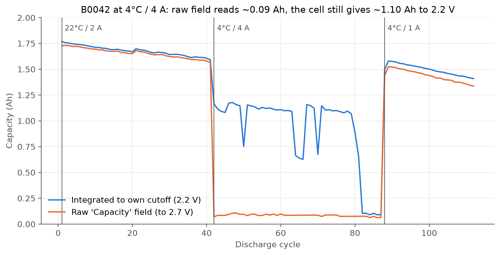
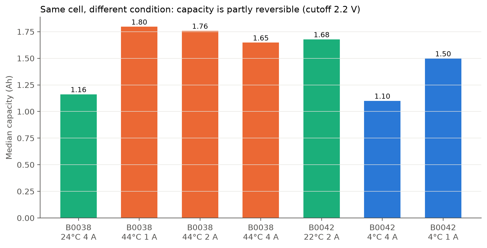
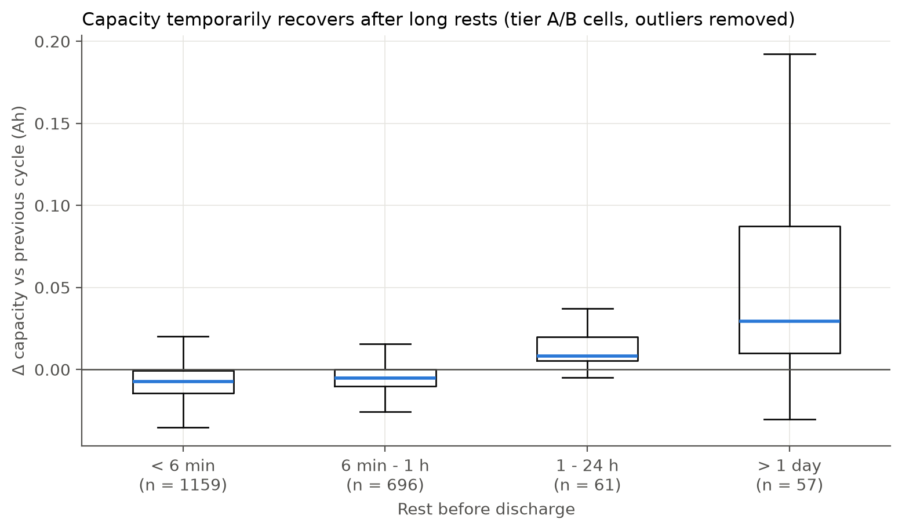
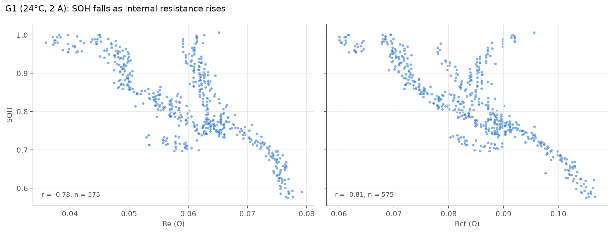
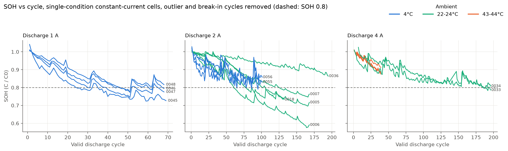
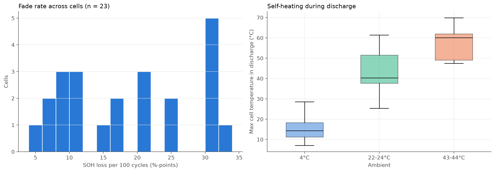

# Introduction of Dataset: NASA PCoE Li-ion Battery Aging Dataset

> **Đề tài:** Statistical and Machine Learning-Based Modeling of Lithium-Ion Battery Degradation and State-of-Health Prognostics under Variable Operating Conditions
> **Môn:** STAT3013 (Intermediate Statistical Analysis), lớp STAT3013.R11.CTTT
> **Nhóm:** Group 08, 4AnhTai (Khải Hưng – Leader, Quốc Đạt, Tiến Hưng, Minh Vũ)
> **Tài liệu liên quan:** [Rec.md](Rec.md) (các quyết định đã chốt) · [Go.md](Go.md) (mô phỏng triển khai từng bước) · [WBS.md](WBS.md) (phân công công việc)
>
> Mọi con số trong tài liệu này được tính lại trực tiếp từ 34 file `.mat` bằng pipeline trong `src/`. Không lấy số liệu từ README gốc khi chưa kiểm chứng. Chạy lại toàn bộ bằng:
> ```bash
> python src/build_dataset.py && python src/clean_dataset.py && python src/eda_dataset.py
> ```

---

## 1. Tổng quan

| Thuộc tính | Giá trị |
|---|---|
| Tên | NASA Ames Prognostics Center of Excellence (PCoE), *Battery Data Set* |
| Trích dẫn | B. Saha and K. Goebel (2007). "Battery Data Set", NASA Prognostics Data Repository, NASA Ames Research Center, Moffett Field, CA |
| Nguồn | https://www.kaggle.com/datasets/ckskaggle/li-ion-battery-dataset-from-nasa-pcoe |
| Đối tượng | 34 cell Li-ion thương mại dạng 18650, dung lượng danh định **2,0 Ah** |
| Thời gian thí nghiệm | 02/04/2008 đến 30/09/2010 (đọc từ timestamp trong file) |
| Số nhóm thí nghiệm | 9 nhóm (G1–G9), mỗi nhóm 3–4 cell chạy song song |
| Định dạng | MATLAB `.mat` (v5), mỗi file là một pin (`B0005.mat` … `B0056.mat`) |
| Kích thước | 2.815 lần sạc, 2.794 lần xả, 1.956 lần đo trở kháng (EIS). Khoảng 7,3 triệu điểm đo thô. |
| Mục đích gốc | Lão hóa tăng tốc bằng sạc/xả lặp lại để nghiên cứu dự báo dung lượng còn lại và tuổi thọ còn lại (RUL) |

**Quy trình lặp lại cho mọi pin:**
- **Sạc:** CC 1,5 A đến 4,2 V, sau đó CV đến khi dòng giảm còn 20 mA. Mất khoảng 2,6–3,0 giờ mỗi lần.
- **Xả:** theo profile riêng của từng nhóm (CC, xung vuông, hoặc tải thay đổi) đến điện áp cắt (cutoff) riêng của từng pin.
- **EIS:** quét tần số 0,1 Hz–5 kHz, chen vào sau khoảng mỗi 4–5 chu kỳ.

**Kiểu dữ liệu (Chap 1, tr. 14): panel data.** Gồm 34 pin (cross-section), mỗi pin là một chuỗi thời gian theo chu kỳ. Đây là đặc điểm chi phối mọi lựa chọn phương pháp ở các phần sau.

### 1.1 Thuật ngữ dùng trong tài liệu

| Thuật ngữ | Nghĩa |
|---|---|
| **Chu kỳ (cycle)** | Một lần sạc đầy rồi xả. Trong tài liệu này, số chu kỳ đếm theo số lần **xả**. |
| **Capacity (Ah)** | Lượng điện tích pin xả ra được trong một lần xả, đơn vị ampe-giờ. |
| **C₀** | Dung lượng lúc pin còn mới, đo trên chính pin đó (định nghĩa chính xác ở Mục 5). |
| **SOH (State of Health)** | Tình trạng sức khỏe pin, SOH = C / C₀. Pin mới có SOH ≈ 1. |
| **EOL (End of Life)** | Ngưỡng coi như hết tuổi thọ. Thường dùng SOH = 0,8 (mất 20%) hoặc 0,7 (mất 30%). |
| **RUL (Remaining Useful Life)** | Số chu kỳ còn lại trước khi pin chạm EOL. |
| **CC / CV** | Constant Current (dòng không đổi) / Constant Voltage (áp không đổi), hai pha của quy trình sạc. |
| **Cutoff voltage** | Điện áp mà khi chạm tới thì dừng xả. Cutoff càng thấp thì xả càng sâu. |
| **EIS** | Electrochemical Impedance Spectroscopy: phép đo trở kháng của pin bằng cách quét tần số. |
| **Re, Rct** | Điện trở điện ly và điện trở chuyển điện tích, ước lượng từ EIS. Cả hai thường tăng khi pin già đi. |
| **Capacity recovery (regeneration)** | Dung lượng tăng tạm thời sau một thời gian pin được nghỉ. |
| **Segment** | Đoạn chu kỳ liên tiếp của cùng một pin có cùng điều kiện vận hành (nhiệt độ, mức dòng). |

### 1.2 Vì sao đổi sang dataset này

| Tiêu chí | Dataset này (NASA PCoE) | Ý nghĩa với đề tài |
|---|---|---|
| Biến mục tiêu | Có dung lượng cho **từng chu kỳ xả**, nên tính SOH trực tiếp | Không phải ước lượng nhãn gián tiếp |
| Điều kiện vận hành thay đổi | Nhiệt độ 4 / 22–24 / 43–44°C; dòng 1 / 2 / 4 A; xung vuông; cutoff 2,0–2,7 V | Khớp trực tiếp với "under Variable Operating Conditions" trong tên đề tài |
| Biến cơ chế | Re, Rct từ EIS; nhiệt độ cell; thông tin sạc | Phân tích được *vì sao* pin suy giảm, không chỉ *bao nhiêu* |
| Độ phổ biến | Là dataset kinh điển, được rất nhiều paper về SOH/RUL sử dụng | Dễ đối chiếu kết quả trong phần Literature Review |
| Kích thước | Nhỏ gọn (khoảng 230 MB), parse một lần ra bảng khoảng 2.800 dòng | Phù hợp với cả Excel/SPSS lẫn Python/R như môn học yêu cầu (Chap 1 §5) |

### 1.3 Mức độ đáp ứng yêu cầu STAT3013

| Phương pháp đề cương yêu cầu | Dataset đáp ứng bằng | Mức đáp ứng |
|---|---|---|
| Descriptive statistics | Phân phối SOH, nhiệt độ, trở kháng theo nhóm điều kiện | Tốt |
| Inferential (t-test, chi-square, ANOVA) | So sánh tốc độ suy giảm giữa các điều kiện, **ở mức pin** | Làm được, nhưng mỗi nhóm có ít pin (n = 2–5) |
| Regression | ln(SOH) theo chu kỳ, điều kiện vận hành và các tương tác | Tốt |
| SEM | Path model: điều kiện → Re/Rct → SOH | Làm được bằng biến quan sát (sau khi học Chap 7) |
| ARIMA / Forecasting | Chuỗi dung lượng theo chu kỳ của từng pin (tối đa 196 điểm sau làm sạch; B0033/B0034 có 197 lần xả gốc) | Tốt với các pin tier A |
| ML / DL | Dự báo SOH chu kỳ kế tiếp từ đặc trưng lag, sạc, trở kháng | Tốt, nhưng dữ liệu nhỏ đối với DL |
| Khuyến nghị kinh doanh | Bảo hành, quản lý đội xe, vận hành trời lạnh/nóng | Làm được. **Không có dữ liệu về thói quen sạc và không có dữ liệu chi phí.** |

---

## 2. Thiết kế thí nghiệm: điều kiện **thực đo**

Bảng dưới đây được dựng từ dữ liệu đo theo từng chu kỳ: nhiệt độ môi trường (`ambient_temperature`) và dòng xả trung bình khi có tải. Các ô đánh dấu ⚠ là chỗ `metadata.csv` hoặc README **sai hoặc thiếu**.

| Nhóm | Pin | Nhiệt độ | Profile xả | Cutoff (V) | Số lần xả | Thời gian | Ghi chú |
|---|---|---|---|---|---|---|---|
| G1 | B0005, B0006, B0007, B0018 | 24°C | CC 2 A | 2,7 / 2,5 / 2,2 / 2,5 | 168/168/168/132 | 04–05/2008 (B0018: 07–08/2008) | Chạy tới EOL. Là tập "kinh điển" trong tài liệu. |
| G2 | B0025–B0027, **B0028** | 24°C | Xung vuông 0,05 Hz (10 s có tải / 10 s nghỉ), biên độ 4 A | 2,0 / 2,2 / 2,5 / 2,7 | 28 | 02–03/2009 | ⚠ **B0028 có biên độ 2 A**, không phải 4 A như metadata ghi. |
| G3 | B0029–B0032 | **43°C** | CC 4 A | 2,0 / 2,2 / 2,5 / 2,7 | 40 | 04/2009 | Chỉ chạy 10 ngày, SOH cuối 0,88–0,91. |
| G4 | B0033, B0034, B0036 | 24°C | CC 4 A (B0033, B0034), CC 2 A (B0036) | 2,0 / 2,2 / 2,7 | 197 | 06–08/2009 | B0033 có giai đoạn break-in và một đợt sụt dung lượng (xem F10). |
| G5 | B0038–B0040 | ⚠ 24°C rồi 44°C | ⚠ Thay đổi theo chu kỳ | 2,2 / 2,5 / 2,7 | 47 | 04–05/2010 | Gồm 4 pha: chu kỳ 1–12 ở 24°C/4 A, 13–39 ở 44°C/1 A, 40–45 ở 44°C/2 A, 46–47 ở 44°C/4 A. |
| G6 | B0041 | 4°C | ⚠ Thay đổi theo chu kỳ | 2,0 | 67 | 06/2010 | Chu kỳ 1–42 ở 4°C/4 A, 43–67 ở 4°C/1 A. |
| G6 | B0042–B0044 | ⚠ **22°C rồi 4°C** | ⚠ Thay đổi theo chu kỳ | 2,2 / 2,5 / 2,7 | 112 | 06/2010 | Chu kỳ 1–41 ở **22°C/2 A**, 42–87 ở 4°C/4 A, 88–112 ở 4°C/1 A. Metadata ghi "4°C" và "1A & 4A". |
| G7 | B0045–B0048 | 4°C | CC 1 A | 2,0 / 2,2 / 2,5 / 2,7 | 72 | 07–08/2010 | B0045 có C₀ thấp bất thường (1,03 Ah so với 1,50–1,56 Ah của các pin cùng nhóm). |
| G8 | B0049–B0052 | 4°C | CC 2 A | 2,0 / 2,2 / 2,5 / 2,7 | 25 | 08/2010 | Phần mềm điều khiển bị crash. **Loại khỏi phân tích.** |
| G9 | B0053–B0056 | 4°C | CC 2 A | 2,0 / 2,2 / 2,5 / 2,7 | 56/103/102/102 | 09/2010 | B0054 có giá trị dung lượng nhảy xen kẽ giữa hai mức (nhiễu). |

**Hệ quả quan trọng: thiết kế thí nghiệm KHÔNG giai thừa.**
- 43°C chỉ đi kèm 4 A. 4°C chỉ đi kèm 1 A hoặc 2 A khi điều kiện giữ không đổi.
- Vì vậy không thể tách hoàn toàn hiệu ứng nhiệt độ khỏi hiệu ứng dòng xả (xem Mục 9.1).

---

## 3. Cấu trúc dữ liệu thô

```
B0005.mat
└── B0005 (struct)
    └── cycle (1×616 struct array)       # mỗi phần tử là MỘT thao tác, không phải một chu kỳ
        ├── type                 'charge' | 'discharge' | 'impedance'
        ├── ambient_temperature  °C (theo từng thao tác)
        ├── time                 MATLAB datevec [Y M D h m s] = thời điểm bắt đầu
        └── data (struct)
```

**Các trường trong `data`.** Tên trường lấy trực tiếp từ file. ⚠ README gốc ghi sai tên ở thao tác xả.

| Thao tác | Trường | Đơn vị | Ghi chú |
|---|---|---|---|
| charge | `Voltage_measured`, `Current_measured`, `Temperature_measured`, `Current_charge`, `Voltage_charge`, `Time` | V, A, °C, A, V, s | Trung vị khoảng 2.180 mẫu mỗi lần sạc. |
| discharge | `Voltage_measured`, `Current_measured` (âm khi xả), `Temperature_measured`, ⚠ `Current_load`, ⚠ `Voltage_load`, `Time`, `Capacity` | V, A, °C, A, V, s, Ah | README ghi nhầm là `Current_charge`/`Voltage_charge`. Trung vị 263 mẫu mỗi lần xả, bước lấy mẫu khoảng 9–14 s. |
| impedance | `Sense_current`, `Battery_current`, `Current_ratio`, `Battery_impedance` (48 điểm, số phức), `Rectified_Impedance` (khoảng 39 điểm), `Re`, `Rct` | A, –, Ω | **File không lưu vector tần số**, nên chỉ dùng được hai đại lượng tóm tắt `Re` (điện trở điện ly) và `Rct` (điện trở chuyển điện tích). |

**Thứ tự thao tác:**
- G1 ban đầu xen kẽ `c d c d …`, về sau chuyển thành `c i d i c …` (có EIS chen giữa sạc và xả).
- Các nhóm khác chủ yếu theo mẫu `i d c d c d c d c i …`.
- Vì vậy phải ghép bảng theo **thứ tự thao tác** (`op_index`), không được ghép theo vị trí.

---

## 4. Các phát hiện quan trọng khi đi sâu vào dữ liệu

### F1. Trường `Capacity` là dung lượng xả **đến 2,7 V**, không phải đến cutoff của pin
- Tích phân dòng xả từ đầu tới lúc điện áp lần đầu xuống dưới 2,7 V khớp với trường `Capacity` ở **98,5% số chu kỳ** (sai lệch dưới 0,01 Ah).
- Đúng như README ghi "*Capacity for discharge till 2.7V*". Tuy nhiên README cũng nói các lần xả có "capacity rất thấp, chưa rõ nguyên nhân".
- **Nguyên nhân thật:** ở 4°C và 4 A, điện trở trong lớn làm điện áp tụt xuống dưới 2,7 V gần như ngay lập tức. Ví dụ B0042 (cutoff 2,2 V): trường `Capacity` chỉ khoảng **0,09 Ah**, nhưng pin vẫn xả được khoảng **1,1 Ah** tới 2,2 V (Hình 2).
- **Quyết định:** dùng `capacity_int_Ah`, tức tích phân dòng điện tới cutoff riêng của pin, làm dung lượng chuẩn. Trường gốc vẫn được giữ trong cột `capacity_Ah` để đối chiếu.



### F2. Điều kiện vận hành thay đổi ngay trong một pin (G5, G6)
- Dung lượng phụ thuộc mạnh và **thuận nghịch** (reversible) vào nhiệt độ và dòng xả tại thời điểm đo. Ví dụ B0038 (cùng cutoff 2,2 V): 1,16 Ah ở 24°C/4 A, rồi 1,80 Ah ở 44°C/1 A ngay chu kỳ sau đó (Hình 4).
- **Quyết định:**
  - Chia mỗi pin thành các *segment*, tức các đoạn liên tiếp có cùng (nhiệt độ, mức dòng).
  - Chỉ tính **SOH** cho pin có một segment duy nhất. Pin nhiều segment dùng `soh_segment`, so với đầu segment.



### F3. Lạnh + dòng lớn + cutoff cao thì gần như không xả được
- Ở 4°C/4 A, các pin có cutoff 2,5 V và 2,7 V (B0043, B0044) chỉ xả được khoảng 0,07–0,08 Ah. Pin có cutoff 2,0 V (B0041) cũng chỉ khoảng 0,07 Ah.
- Pin có cutoff 2,2 V (B0042) xả được khoảng 1,1 Ah, nhưng tụt xuống khoảng 0,1 Ah ở các chu kỳ 82–87.
- Đây là **giới hạn công suất do lạnh**, không phải pin bị lão hóa: khi chuyển về 4°C/1 A, dung lượng hồi lại 1,36–1,50 Ah.
- *Ý nghĩa thực tế:* xe điện hay drone vận hành tải nặng trong trời lạnh sẽ "mất" phần lớn dung lượng **tạm thời**.

### F4. Lần xả đầu tiên không có lần sạc trước đó
- 19 lần xả (thường là chu kỳ 1) diễn ra khi pin chưa được sạc đầy theo quy trình chuẩn, nên dung lượng không đại diện. Đã **loại**.

### F5. Dung lượng tăng tạm thời sau thời gian nghỉ dài (capacity recovery)
Mức thay đổi dung lượng so với chu kỳ trước, tính trên các pin tier A/B:

| Thời gian nghỉ trước khi xả | n | Trung vị ΔC (Ah) |
|---|---|---|
| < 6 phút | 1.160 | −0,0074 |
| 6 phút – 1 giờ | 696 | −0,0052 |
| 1 – 24 giờ | 61 | +0,0081 |
| > 1 ngày | 57 | **+0,0294** |

> ⚠ **Cập nhật ngày 26/10/2026:** bảng này **chưa tái tạo được** bằng pipeline mới. Chạy thử trên 22 pin tier A/B, chưa bỏ dòng gắn cờ, ΔC tính giữa hai dòng hợp lệ liền kề, cho n = 1.167 / 701 / 64 / 66 và trung vị nhóm > 1 ngày là +0,0374 Ah. Chưa rõ bảng cũ dùng tập dữ liệu và cách tính ΔC nào. Sẽ kiểm tra lại khi viết phần EDA của `src/eda_dataset.py`. **Không trích các con số trong bảng này vào báo cáo cho tới khi tái tạo được.** Kết luận định tính (dung lượng tăng sau nghỉ dài) vẫn giữ nguyên.

- Đây là hiện tượng điện hóa có thật, không phải lỗi đo, nên **không xóa**. Cột `long_rest` (nghỉ hơn 1 giờ) được tạo làm biến giải thích.
- Đây cũng là nguồn chính tạo ra các "răng cưa" trên đường SOH (Hình 1, Hình 3).



### F6. Dữ liệu trở kháng
- Trung bình khoảng 4–5 chu kỳ có một lần đo EIS. Với mỗi lần xả, dùng giá trị Re/Rct **gần nhất trước đó**, tuyệt đối không lấy giá trị đo sau (tránh rò rỉ thông tin tương lai).
- 57 lần xả đầu tiên xảy ra trước lần EIS đầu tiên, nên Re/Rct để trống.
- **Giá trị phi vật lý:** B0050 có Re = −9,7·10¹⁴ Ω, B0052 có Re/Rct lên tới hàng nghìn Ω. Quy tắc: chỉ giữ giá trị trong khoảng (0; 0,5) Ω.
- Trường `ambient_temperature` của các thao tác EIS ghi 24°C cho cả những nhóm chạy ở 4°C (riêng G3 ghi 43°C). Khả năng EIS được đo ở nhiệt độ phòng; khi diễn giải cần thận trọng.
- Ở G1, tương quan giữa SOH với Re là −0,78 và với Rct là −0,81 (Hình 5).



### F7. Đặc trưng lấy từ quá trình sạc cũng dự báo được SOH
- Thời gian pha CC khi sạc (`chg_cc_time_s`) tương quan **0,86** với SOH ở G1.
- Biến này đo được **trước** lần xả, nên là biến dự báo hợp lệ.
- *Ý nghĩa kinh doanh:* hệ thống quản lý pin (BMS) có thể ước lượng SOH chỉ từ lúc sạc, không cần xả kiểm tra.

### F8. Pin chênh lệch nhau ngay từ khi mới (cell-to-cell variation)
- Ở 24°C/2 A, C₀ của G1 dao động từ 1,85 đến 2,04 Ah (trung bình 1,91 Ah). **Không pin nào đạt 2,0 Ah danh định một cách ổn định.**
- Vì vậy chuẩn hóa SOH theo C₀ của **chính pin đó**, không theo 2,0 Ah.
- B0045 có C₀ chỉ 1,03 Ah, nhiều khả năng là cell lỗi từ đầu.

### F9. Các chu kỳ trong một pin phụ thuộc mạnh vào nhau
- Phần dư sau khi fit xu hướng tuyến tính có tự tương quan bậc 1 là **0,40–0,93** ở các pin tier A (10/12 pin trên 0,75).
- Kiểm định ADF: chuỗi capacity gốc **không dừng** (p = 0,53–0,89), chuỗi sai phân bậc 1 dừng (p < 0,001).
- **Hệ quả:**
  - Kiểm định suy diễn phải dùng **pin** làm đơn vị quan sát.
  - ARIMA cần d = 1.
  - Chia train/test phải theo pin, không chia ngẫu nhiên theo chu kỳ.

### F10. Một số giai đoạn sụt bất thường
- **B0033:** 6 chu kỳ break-in đầu (0,72 → 1,38 Ah, sau đó lên 1,84 Ah). Thêm một đợt sụt ở chu kỳ 139–148 xuống còn 0,22–0,53 Ah, rồi hồi phục về 1,6 Ah.
- Đây là kiểu *collective anomaly* (Chap 6, tr. 69). Đã gắn cờ `break_in` và `cap_outlier` nhưng **không xóa**.

### F11. Pin hỏng hoặc dữ liệu hỏng
- **B0052:** dòng tải luôn khoảng 0 A, trường `Capacity` rỗng.
- **B0049–B0051:** phần mềm crash, chỉ có 25 chu kỳ, dung lượng nhảy lên 2,4–3,0 Ah, vượt cả định mức 2,0 Ah. Đây là điều **phi vật lý**.
- Cả nhóm G8 bị **loại**.

---

## 5. Pipeline xử lý dữ liệu

| Bước | Script | Việc làm | Kiến thức (slide) |
|---|---|---|---|
| 1. Parse | `src/build_dataset.py` | Làm phẳng struct lồng nhau (semi-structured) thành bảng structured. Gộp hàng trăm/nghìn điểm đo thành **1 dòng mỗi thao tác**. Chuyển datevec sang datetime, số phức sang số thực. | Chap 1 tr. 13 (phân loại dữ liệu), tr. 15–16 (format transformation, aggregation) |
| 2. Join | `build_dataset.py` | Mỗi lần xả được ghép với lần sạc ngay trước nó (`merge_asof` theo `op_index`) và lần EIS gần nhất **trước** nó. Ghép thêm metadata. | Chap 1 tr. 16 (data integration) |
| 3. Clean | `src/clean_dataset.py` | Áp dụng các quy tắc loại bỏ (bảng dưới), lọc trở kháng, chia segment, tính C₀/SOH, gắn cờ outlier/break-in, xếp tier cho từng pin. | Chap 1 tr. 17 (missing data), Chap 6 tr. 69 (anomaly) |
| 4. EDA | `src/eda_dataset.py` | Thống kê mô tả, tốc độ suy giảm theo pin, kiểm định ADF, các hình 1–6. | Chap 1 §3–4, Chap 5 tr. 11–14 |

**Quy tắc loại bỏ** (tổng 2.794 dòng → còn **2.658** dòng hợp lệ):

| Lý do | Số dòng |
|---|---|
| Pin bị loại (G8: B0049–B0052) | 100 |
| Không có lần sạc trước đó | 19 |
| Không chạm tới cutoff (lần xả bị cắt ngang, V_min > cutoff + 0,1 V) | 16 |
| Dung lượng ngoài khoảng [0,05; 2,1] Ah | 1 |

**Các cờ được giữ lại để từng phân tích tự quyết định có dùng hay không:**
- `cap_outlier` (57 dòng): Hampel filter (cửa sổ 7, ngưỡng 3·MAD và tối thiểu 0,05 Ah), **hoặc** dung lượng giảm hơn 25% so với giá trị lớn nhất của 10 chu kỳ trước.
- `break_in` (17 dòng).
- `long_rest` (167 dòng).

**Định nghĩa SOH:**
```
C0  = max của trung vị trượt 3 chu kỳ, xét trong 10 chu kỳ hợp lệ đầu tiên
      (vững trước giá trị đơn lẻ bất thường và trước giai đoạn break-in thấp)
SOH = capacity_int_Ah / C0          (chỉ áp dụng cho pin có 1 segment)
soh_segment = capacity_int_Ah / C0 của segment đó   (áp dụng cho mọi pin)
```
*Vì sao C₀ không dùng giá trị đầu tiên:* chu kỳ đầu thường bất thường (F4, F10). Lấy trung vị phù hợp theo Chap 1 tr. 41: median không bị ảnh hưởng bởi giá trị ở hai đầu phân phối.

**Các file đầu ra** trong `data/processed/` (không commit, chạy lại bằng script):
| File | Script | Số dòng | Một dòng là |
|---|---|---|---|
| `discharge_ops.csv` | `build_dataset.py` | 2.794 | Một lần xả (chưa ghép, chưa lọc) |
| `charge_ops.csv` | `build_dataset.py` | 2.815 | Một lần sạc: `chg_duration_s`, `chg_end_time`, `chg_charge_Ah`, `chg_cc_time_s`, `chg_T_max_C` |
| `impedance_ops.csv` | `build_dataset.py` | 1.956 | Một lần EIS: `Re_ohm`, `Rct_ohm` **thô** (chưa lọc; 9 giá trị NaN do số phức, đều ở G8) |
| `cycles.csv` | `build_dataset.py` | 2.794 | Một lần xả, đã ghép với lần sạc, lần EIS trước và metadata, **chưa làm sạch** |
| **`cycles_clean.csv`** | `clean_dataset.py` | **2.658** | **Một lần xả hợp lệ. Bảng dùng chung cho cả nhóm.** |
| `cycles_dropped.csv` | `clean_dataset.py` | 136 | Một lần xả bị loại, kèm cột `drop_reason` (`excluded_battery` / `no_preceding_charge` / `cutoff_not_reached` / `capacity_out_of_range`) |
| `battery_summary.csv` | `clean_dataset.py` | 34 | Một pin, kèm tier (gồm cả 4 pin X) |
| `battery_fade.csv` | `eda_dataset.py` | 23 | Một pin có điều kiện không đổi (tier A, B, N): tốc độ suy giảm, là đơn vị cho kiểm định |

---

## 6. Từ điển dữ liệu: `cycles_clean.csv` (mỗi dòng là một lần xả hợp lệ)

| Biến | Đơn vị | Thang đo (Chap 1) | Ý nghĩa |
|---|---|---|---|
| `battery_id`, `group` | – | Nominal | Mã pin, mã nhóm thí nghiệm |
| `op_index` | – | Ratio (rời rạc) | Vị trí của thao tác xả trong mảng `cycle` của file `.mat`, **đếm từ 0**. Dùng để ghép với lần sạc và lần EIS trước đó. |
| `chg_op_index` | – | Ratio (rời rạc) | `op_index` của lần sạc được ghép với lần xả này: lần sạc gần nhất có `op_index` nhỏ hơn hẳn, trong cùng pin. Luôn có `chg_op_index < op_index`. |
| `cycle` | – | Ratio (rời rạc) | Số thứ tự lần xả trong dữ liệu gốc |
| `cycle_valid` | – | Ratio (rời rạc) | Số thứ tự lần xả trong các dòng **hợp lệ** của pin, **đếm từ 1**. **Có** tính các dòng `cap_outlier` và `break_in`. **Dùng làm trục thời gian.** |
| `segment` | – | Ordinal | Đoạn điều kiện thứ mấy trong pin, đánh số từ 1. Khóa segment = (`ambient_C`, `I_level_A`); segment mới bắt đầu khi khóa khác dòng hợp lệ liền trước của cùng pin. 22°C và 24°C tính là hai mức khác nhau. |
| `start_time` | datetime | Interval | Thời điểm bắt đầu xả |
| `ambient_C` | °C | **Interval** | Nhiệt độ môi trường, lấy từ `ambient_temperature` của **chính thao tác xả** (không lấy từ EIS, vì EIS luôn ghi 24°C hoặc 43°C). Slide tr. 26 lấy chính nhiệt độ làm ví dụ interval: được tính mean/SD, nhưng không được nói "43°C nóng gấp đôi 24°C". |
| `I_level_A` | A | Ratio | Mức dòng xả (1, 2 hoặc 4) = `round(I_load_mean_A)`. Với xung vuông là biên độ (B0028 = 2 A). |
| `profile` | – | Nominal | `constant_current` hoặc `square_wave_0.05Hz` |
| `discharge_cutoff_V` | V | Ratio | Điện áp cắt, đại diện cho độ sâu xả |
| `capacity_Ah` | Ah | Ratio | Trường gốc (dung lượng đến 2,7 V). **Chỉ dùng để đối chiếu.** |
| `capacity_to_2p7V_Ah` | Ah | Ratio | Tính lại từ dữ liệu, để kiểm chứng F1. Cùng công thức với `capacity_int_Ah` nhưng **dừng** ở mẫu đầu tiên có `Voltage_measured < 2,7` (tính cả mẫu đó). |
| **`capacity_int_Ah`** | Ah | Ratio | **Dung lượng chuẩn:** tích phân `Current_measured` theo `Time` bằng công thức hình thang, chỉ trên các mẫu có tải (I < −0,1 A, đổi dấu thành dương; mẫu khác bằng 0), **hết chuỗi**. Khi chạm cutoff riêng của pin dòng tải về khoảng 0, nên kết quả là dung lượng tới cutoff. Công thức: `Σ (y[k] + y[k−1]) / 2 · (t[k] − t[k−1]) / 3600`. |
| `C0_Ah`, **`soh`**, `soh_segment` | Ah, – | Ratio | Dung lượng lúc mới và SOH (định nghĩa ở Mục 5; cách cài đặt C₀ ở [Rec.md](Rec.md) mục 2.1) |
| `energy_Wh`, `duration_s`, `t_to_cutoff_s` | Wh, s, s | Ratio | `duration_s` = `Time[-1]`; `t_to_cutoff_s` = `Time` của mẫu có tải cuối cùng; `energy_Wh` = hình thang của V × dòng tải (chỉ mẫu có tải) / 3.600. ⚠ Gần như là hàm của chính dung lượng (tương quan khoảng 1,0). **Không dùng làm biến dự báo SOH của cùng chu kỳ đó.** |
| `I_load_mean_A`, `V_min` | A, V | Ratio | Dòng tải trung bình (trung bình \|I\| **chỉ trên các mẫu có tải**, I < −0,1 A), điện áp thấp nhất của cả chuỗi |
| `T_start_C`, `T_max_C`, `T_mean_C` | °C | Interval | Nhiệt độ của chính cell khi xả (thể hiện mức tự phát nhiệt): mẫu đầu, max và mean trên toàn chuỗi |
| `n_samples` | – | Ratio | Số mẫu đo của lần xả |
| `chg_op_index`, `chg_charge_Ah`, `chg_cc_time_s`, `chg_duration_s`, `chg_end_time`, `chg_T_max_C` | –, Ah, s, s, datetime, °C | Ratio | Thông tin của lần sạc được ghép. `chg_charge_Ah` = hình thang của I chỉ trên mẫu I > 0,1 A (bỏ nhiễu khởi động như −4 A); `chg_cc_time_s` = `Time` của mẫu đầu tiên có `Voltage_measured` ≥ 4,2 V, tức hết pha CC (NaN nếu không chạm); `chg_duration_s` = `Time[-1]`; `chg_end_time` = giờ bắt đầu sạc + `chg_duration_s`. **Biết được trước khi xả, nên là biến dự báo hợp lệ.** |
| `n_chg_since_prev_dis` | – | Ratio (rời rạc) | Số lần sạc nằm giữa lần xả trước và lần xả này. Trên dòng hợp lệ: **1** ở 2.639 dòng (bình thường); **2** ở 16 dòng (G1 lần 12, 31 của B0005–07, lần 46, 56 của B0018; G2 lần 8, 23): lần sạc được ghép có thể chỉ là sạc bù, khi đó `chg_cc_time_s` ≈ 0; **0** ở 3 dòng (lần 90 của B0005–07). Dùng để lọc hoặc kiểm tra độ vững khi dùng đặc trưng sạc. |
| `rest_before_h`, `long_rest` | h, bool | Ratio, Nominal | Thời gian nghỉ từ lúc lần sạc được ghép (`chg_op_index`) kết thúc đến lúc xả (giải thích F5). ⚠ Ở lần xả thứ 90 của B0005, B0006, B0007, lần sạc được ghép nằm trước một lần xả khác, nên `chg_*` và `rest_before_h` của 3 dòng này mô tả lần sạc cũ hơn (xem Rec.md mục 2.1, dòng 2b). |
| `eis_op_index`, `Re_ohm`, `Rct_ohm` | –, Ω | Ratio | Trở kháng của lần EIS gần nhất **trước** lần xả. Giá trị ngoài (0; 0,5) Ω bị đặt NaN rồi điền bằng giá trị hợp lệ trước đó của cùng pin (trên 2.658 dòng hợp lệ, bộ lọc không thay đổi giá trị nào; mọi giá trị sai đều ở G8). 57 dòng trống (19 dòng đầu của B0005, B0006, B0007, trước lần EIS đầu tiên). |
| `cap_outlier`, `break_in` | bool | Nominal | Các cờ chất lượng dữ liệu (cách tính ở Rec.md mục 2.1). `break_in` xét `cycle_valid` ≤ 10 (Rec.md mục 2.2). |
| `tier` | – | Nominal | Tier của pin (A / B / C / N), lấy từ `battery_summary.csv` |

### 6.1 Biến suy ra khi phân tích (không phải cột trong file)

| Biến | Định nghĩa | Ghi chú |
|---|---|---|
| `temp` | `"4°C"` nếu `ambient_C < 10`; `"22-24°C"` nếu `ambient_C < 30`; còn lại `"43-44°C"` | Dùng trong `C(temp)` của công thức hồi quy. ⚠ Ở đây **22°C và 24°C được gộp làm một mức**, khác với cách chia segment (tách hai mức). |

### 6.2 Các cột ở mức pin: `battery_summary.csv` và `battery_fade.csv`

| Biến | File | Định nghĩa |
|---|---|---|
| `battery_id`, `group`, `profile`, `discharge_cutoff_V` | cả hai | Định danh và điều kiện cố định của pin |
| `ambient_C`, `I_level_A` | cả hai | Điều kiện của pin 1 segment; NaN với pin nhiều segment (điều kiện từng segment xem trong `cycles_clean.csv`) |
| `tier` | cả hai | A / B / C / N / X (summary); A / B / N (fade) |
| `n_discharges_raw`, `n_dropped` | summary | Số lần xả gốc và số dòng bị loại ở bước làm sạch. Tổng `n_dropped` = 136. |
| `n_segments`, `n_break_in` | summary | Số segment; số dòng `break_in` |
| `C0_Ah` | summary | C₀ của pin 1 segment; NaN với pin nhiều segment |
| `n_valid` | summary | Số dòng hợp lệ của pin, **đã bỏ `break_in`**, có tính `cap_outlier`. Dùng cho quy tắc tier "≥ 60 chu kỳ". |
| `n_cap_outlier` | summary | Số dòng `cap_outlier` trong tập trên. Tỉ lệ outlier = `n_cap_outlier / n_valid` (tier N khi > 10%). |
| `soh_min` | summary | SOH nhỏ nhất trên các dòng hợp lệ, đã bỏ cả `break_in` và `cap_outlier` |
| `soh_last` | summary | ⚠ SOH của dòng cuối, đã bỏ `break_in` nhưng **có** tính `cap_outlier` |
| `soh_last` | fade | ⚠ SOH của dòng cuối, đã bỏ **cả** `cap_outlier` lẫn `break_in`. Cùng tên nhưng khác nghĩa với cột trong summary; khi dùng phải ghi rõ lấy từ file nào. |
| `cycles_to_soh80` | fade | `cycle_valid` đầu tiên có `soh < 0,8` (nhỏ hơn hẳn), trên các dòng đã bỏ `cap_outlier` và `break_in`. NaN nếu chưa bao giờ chạm. |
| `fade_pct_per_100cyc` | fade | `−slope × 100 × 100`, với `slope` là hệ số dốc của `np.polyfit(cycle_valid, soh, 1)` trên toàn bộ dòng của pin đã bỏ `cap_outlier` và `break_in`. Đơn vị: điểm % SOH mất đi sau 100 chu kỳ. |
| `fade25_pct_per_100cyc` | fade | Như trên, chỉ lấy các dòng có `cycle_valid ≤ 25`. Vì đã bỏ outlier nên có thể ít hơn 25 điểm. |
| `T_max_med` | fade | Trung vị của `T_max_C` trên các dòng đã bỏ `cap_outlier` và `break_in` |
| `n_used`, `n_used25` | fade | Số dòng dùng để fit `fade_pct_per_100cyc` và `fade25_pct_per_100cyc`. `n_used25` < 25 ở B0026 (22), B0033 (19), B0045 (23), B0054 (15). |

`battery_fade.csv` gồm các pin tier A, B và N (23 pin có điều kiện không đổi). Ở pin X, `battery_summary.csv` chỉ có `n_discharges_raw` = `n_dropped` = 25; các cột thống kê để trống.

---

## 7. Phân tầng pin theo mục đích sử dụng

| Tier | Quy tắc (tự động, trong `clean_dataset.py`) | Pin | Số dòng | Dùng cho |
|---|---|---|---|---|
| **A**: điều kiện không đổi, chạy dài, đã suy giảm rõ | 1 segment, ≥ 60 chu kỳ, SOH_min ≤ 0,85 | B0005, 06, 07, 18, B0033, 34, B0045–48, B0055, 56 | 1.503 | Hồi quy, ARIMA, ML/DL, dự báo RUL |
| **B**: điều kiện không đổi nhưng ngắn hoặc suy giảm ít | 1 segment, không đạt điều kiện tier A | B0025–28, B0029–32, B0036, B0053 | 517 | So sánh tốc độ suy giảm giữa các điều kiện. Dùng làm pin test. |
| **C**: điều kiện thay đổi | Từ 2 segment trở lên | B0038–40, B0041–44 | 537 | Đo hiệu ứng thuận nghịch của nhiệt độ và dòng xả lên dung lượng tức thời |
| **N**: nhiễu | Trên 10% số chu kỳ là outlier | B0054 | 101 | Chỉ dùng để kiểm tra độ vững |
| **X**: loại bỏ | Dữ liệu hỏng | B0049–B0052 | 0 | – |

---

## 8. Thống kê mô tả ban đầu (Chap 1 §3–4)

**Tính ở mức chu kỳ**, trên các pin tier A/B/N, đã bỏ các dòng outlier và break-in (n = 2.065):

| Biến | Mean | Median | SD | SE | Min | Max | Skewness | Kurtosis |
|---|---|---|---|---|---|---|---|---|
| capacity_int (Ah) | 1,506 | 1,512 | 0,254 | 0,006 | 0,746 | 2,047 | −0,52 | 2,92 |
| SOH | 0,877 | 0,886 | 0,087 | 0,002 | 0,576 | 1,041 | −0,64 | 3,07 |
| T_max (°C) | 36,8 | 38,7 | 15,7 | 0,34 | 10,2 | 63,0 | −0,13 | 1,95 |
| Re (Ω) | 0,082 | 0,079 | 0,024 | 0,001 | 0,028 | 0,138 | 0,07 | 2,30 |
| Rct (Ω) | 0,128 | 0,123 | 0,049 | 0,001 | 0,040 | 0,252 | 0,44 | 2,28 |
| rest_before (h) | 3,19 | 0,02 | 19,8 | 0,44 | 0,02 | 303,9 | 10,6 | 137 |

Kurtosis ở đây là Pearson kurtosis (phân phối chuẩn = 3), đúng quy ước trên slide.

**Cách đọc:**
- **SOH:** skewness âm, nghĩa là phần lớn quan sát nằm ở phía SOH cao (theo tr. 49, phân phối lệch về phía giá trị lớn). Lý do là pin dành nhiều chu kỳ ở giai đoạn đầu, khi SOH còn cao.
- **rest_before:** lệch phải cực mạnh. Gần như mọi chu kỳ nghỉ khoảng 1 phút, nhưng có một số ít nghỉ nhiều ngày. Nên dùng log hoặc chia nhóm (Chap 1 tr. 17).
- **T_max:** kurtosis < 3 và có nhiều đỉnh, vì gộp ba mức nhiệt độ môi trường. Khi mô tả biến này nên tách theo nhóm nhiệt độ:

| Nhiệt độ môi trường | n | T_max trung vị | Khoảng |
|---|---|---|---|
| 4°C | 602 | 15,0°C | 10,2–25,4 |
| 22–24°C | 1.307 | 40,6°C | 25,4–61,1 (ở 4 A lên tới khoảng 57°C) |
| 43–44°C | 156 | 61,8°C | 59,6–63,0 |

**Tốc độ suy giảm ở mức pin.** Đơn vị là số điểm % SOH mất đi sau 100 chu kỳ, ước lượng bằng hồi quy tuyến tính trong từng pin. Lưu trong `battery_fade.csv`.

| Điều kiện | Số pin | Toàn bộ chuỗi: mean (min–max) | 25 chu kỳ đầu: mean |
|---|---|---|---|
| 24°C, CC 2 A (G1 + B0036) | 5 | 17,9 (5,9–24,7) | 14,4 |
| 24°C, CC 4 A (B0033, B0034) | 2 | 8,3 (6,8–9,7) | 20,1 |
| 24°C, xung vuông 4 A / 2 A | 3 / 1 | 10,9 / 14,6 | 9,7 / 13,3 |
| **43°C, CC 4 A (G3)** | 4 | **28,4** (21,4–30,9) | 27,8 |
| **4°C, CC 1 A (G7)** | 4 | **29,9** (25,4–32,0) | 64,8 |
| 4°C, CC 2 A (G9, không gồm B0054) | 3 | 10,0 (9,5–10,3) | 27,9 |

Các nhận xét dưới đây **là giả thuyết, sẽ kiểm định ở Chap 2**:
1. **Ở cùng dòng 4 A, pin ở 43°C suy giảm nhanh hơn pin ở 24°C**, xét trên cùng cửa sổ 25 chu kỳ: 27,8 so với 20,1. Kết luận nhất quán nhưng chỉ có 4 và 2 pin.
2. **Ở 4°C, dòng 1 A lại suy giảm nhanh hơn dòng 2 A.** Đây là điều ngược trực giác. Một giải thích khả dĩ: ở 2 A cell tự phát nhiệt nhiều hơn (T_max trung vị khoảng 15–21°C ở G9, so với 11–16°C ở G7), làm giảm tác hại của nhiệt độ thấp. Như vậy **nhiệt độ của chính cell** có thể là biến quan trọng hơn nhiệt độ môi trường.
3. **Kết luận phụ thuộc vào cách đo tốc độ suy giảm.** Toàn bộ chuỗi và 25 chu kỳ đầu cho thứ hạng khác nhau, vì đường suy giảm không tuyến tính và các nhóm chạy số chu kỳ khác nhau (28–197). Báo cáo phải nêu rõ đã dùng cách đo nào, và trình bày cả hai.




---

## 9. Hướng triển khai cho phần sau

### 9.1 Phần cả nhóm làm chung: thống kê mô tả và thống kê suy diễn (Chap 1–2)
- **Đơn vị quan sát là pin.** Lấy từ `battery_fade.csv`, gồm 23 pin có điều kiện không đổi. Lý do: các chu kỳ trong cùng một pin phụ thuộc nhau (F9).
- **Cặp so sánh chỉ khác một yếu tố:**

| Yếu tố cần xét | So sánh | Yếu tố giữ cố định |
|---|---|---|
| Nhiệt độ | G3 (43°C) với B0033/B0034 (24°C) | 4 A, CC |
| Nhiệt độ | G1 (24°C) với G9 (4°C) | 2 A, CC |
| Dòng xả | G7 (1 A) với G9 (2 A) | 4°C |
| Profile | G2 xung vuông 4 A với B0033/B0034 CC 4 A | 24°C |

- Mỗi nhóm có n < 30, nên dùng **t-test** (Chap 2 tr. 8). Kiểm tra F-test hoặc Levene trước để quyết định dùng t-test pooled hay không.
- One-way ANOVA với Tukey dùng được khi xét theo "nhóm điều kiện". **Two-way ANOVA không làm được đầy đủ**, vì thiếu các ô (43°C/2 A) và (24°C/1 A).
- Ở mức pin, hiệu ứng thuận nghịch của nhiệt độ và dòng xả lên dung lượng tức thời lấy từ tier C (Hình 4). Đây là bằng chứng cho khuyến nghị "vận hành trời lạnh".

### 9.2 Phần modeling: mỗi người một thuật toán, dùng **chung dữ liệu và chung cách đánh giá**

**Quy ước chung bắt buộc:**
- Biến mục tiêu là `soh`, dùng tier A, bỏ các dòng `cap_outlier` và `break_in`.
- **Chia train/test theo pin**, mỗi điều kiện có một pin test. Đề xuất: test = {B0007 (G1), B0034 (G4), B0047 (G7), B0055 (G9)}, train là các pin tier A còn lại. Có thể bổ sung leave-one-battery-out để kiểm tra độ vững.
- Metric chung: MAE, RMSE, MAPE, R² (Chap 3 tr. 81–86). Báo cáo trên **cùng một tập test** để ghép được vào một bảng so sánh.
- **Cấm làm rò rỉ dữ liệu:**
  - Không dùng `energy_Wh`, `duration_s`, `t_to_cutoff_s`, `capacity_*` của **cùng chu kỳ** làm biến dự báo.
  - Chỉ dùng giá trị của các chu kỳ trước (lag), thông tin sạc của chu kỳ đó (`chg_*`), Re/Rct đã đo trước đó, và điều kiện vận hành.

| Thành viên | Thuật toán | Dữ liệu và cách dựng | Câu hỏi trả lời |
|---|---|---|---|
| **Quốc Đạt** (thống kê truyền thống) | **Hồi quy bội log-linear có tương tác** (Chap 3) | Biến phụ thuộc ln(soh). Biến giải thích: cycle_valid, dummy nhiệt độ (k−1), I_level_A, cutoff, các tương tác cycle×dummy. Kiểm tra VIF: Re/Rct tương quan 0,97 trong G1 nhưng chỉ 0,43 trên tier A. Kiểm tra residual plot. Thêm phiên bản 2 bước trên `battery_fade.csv`. | Mỗi yếu tố làm SOH thay đổi bao nhiêu % mỗi chu kỳ |
| **Tiến Hưng** (thống kê truyền thống) | **ARIMA / ARIMAX** (Chap 5) | Chuỗi `capacity_int_Ah` theo `cycle_valid` của từng pin tier A. Dùng d = 1 (ADF đã xác nhận). Biến ngoại sinh: `rest_before_h` để giải thích F5, `Rct_ohm`. Không cần SARIMA vì không có tính mùa vụ cố định. | Dự báo SOH ngắn hạn, thời điểm chạm 80%, giá trị của biến ngoại sinh |
| **Minh Vũ** (ML) | **SVR** (Chap 6) | Đặc trưng: SOH từ lag 1 đến lag 5, rolling mean, `chg_cc_time_s`, Re, Rct, `T_max` của chu kỳ trước, điều kiện vận hành, `rest_before_h`. Scale bằng z-score, chỉ fit trên train. | Dự báo SOH chu kỳ kế tiếp. Permutation importance để đối chiếu với kết quả hồi quy của Quốc Đạt. |
| **Khải Hưng** (DL, Leader) | **LSTM** (Chap 6) | Đầu vào là cửa sổ 10 chu kỳ (cùng bộ đặc trưng với SVR), đầu ra là SOH chu kỳ kế. Mô hình nhỏ (1 lớp, 32 đơn vị), dùng early stopping. Chỉ có khoảng 1.500 dòng tier A, nên báo cáo trung thực nếu mô hình không thắng ML (Chap 6 tr. 13). | ML và DL có khác biệt gì trên dữ liệu nhỏ |

**Sensitivity của cảnh báo EOL (Khải Hưng, giai đoạn so sánh mô hình):** từ dự báo của mỗi mô hình, suy ra cảnh báo "chạm SOH 0,8 trong 20 chu kỳ tới (có/không)", rồi tính sensitivity, specificity và confusion matrix theo Chap 4. Không fit thêm mô hình logistic. Chi tiết ở [Rec.md](Rec.md) mục 6.

---

## 10. Hạn chế của dataset (đưa vào mục Limitations của báo cáo)
1. **Quy mô nhỏ:** chỉ 23 pin có điều kiện không đổi, mỗi điều kiện 1–5 pin. Khoảng tin cậy sẽ rộng.
2. **Thiết kế không giai thừa:** nhiệt độ bị lẫn với dòng xả (Mục 2).
3. **Quy trình sạc cố định** CC 1,5 A / CV 4,2 V. **Không phân tích được thói quen sạc** như sạc nhanh hay sạc một phần. Chỉ có điện áp cắt làm đại diện cho độ sâu xả.
4. Đây là **cell đơn trong phòng thí nghiệm**, chạy tải CC hoặc xung vuông. Không phải pack, không phải chu trình lái xe thực tế, không có dữ liệu lão hóa do lưu trữ (calendar aging).
5. **Không có dữ liệu kinh tế** (giá pin, chi phí bảo hành). Phần khuyến nghị kinh doanh phải dùng giả định từ nguồn bên ngoài, kèm phân tích độ nhạy.
6. Dữ liệu EIS không có vector tần số. Nhiệt độ ghi cho các lần EIS chưa chắc chắn (F6).
