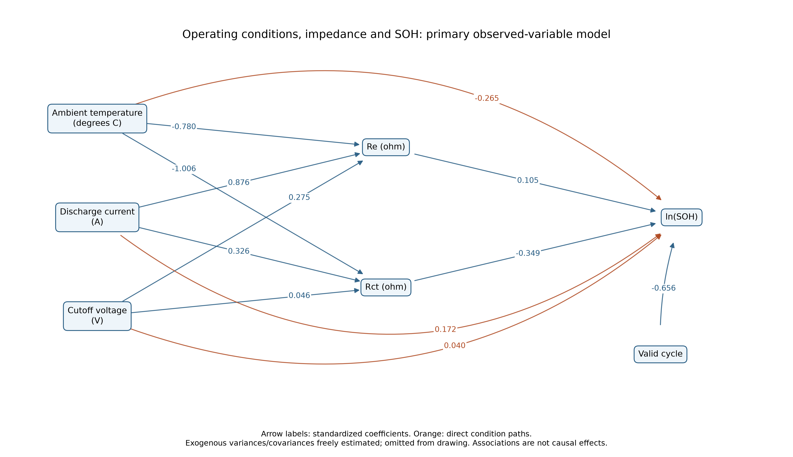

# SEM / path analysis methods and results — Quoc Dat

Generated from executed outputs on 2026-11-10. Integration targets: Full Report §§3.7/4/5.7 and IEEE Methodology/Results.

## Theoretical framework and hypotheses

Operating temperature, discharge current and cutoff voltage may be associated with electrolyte resistance Re and
charge-transfer resistance Rct, which in turn may be associated with SOH. Direct condition–SOH paths remain in the model.
Age (`cycle_valid`) controls the SOH equation. All variables are observed; the dataset does not justify a latent measurement model.
The hypotheses are the existence of direct and indirect **associations** through each impedance measure, not a presupposed sign
or causal mediation conclusion. Observational data, unmeasured battery heterogeneity, and temperature/age confounding prevent causal identification.

For condition vector X, the primary equations are

`Re = a_Re'X + ε_Re`, `Rct = a_Rct'X + ε_Rct`,
`ln(SOH) = c'X + b_Re Re + b_Rct Rct + γ cycle_valid + ε_Y`.

All four exogenous variables have freely estimated variances and covariances. The primary residual covariance Re ~~ Rct remains fixed at zero,
matching the original theory. Age-to-mediator paths and shared mediator residual covariance are investigated only as named sensitivities.
The model is a covariance model, without a fitted mean/intercept structure.

## Data and measurement audit

| stage | n |
| --- | --- |
| Tier A/B cycle rows | 2020 |
| Distinct linked EIS operations | 812 |
| Raw EIS invalid or missing | 0 |
| Analysis complete cases | 812 |
| Independent battery blocks | 22 |
| Cleaned/raw resistance mismatches replaced | 0 |
| Flagged rows retained in historical/theory sample | 14 |

Use Tier A/B rows and the first retained discharge linked to each unique `(battery_id,eis_op_index)`.
Join raw `impedance_ops.csv` by this key and require both raw resistances in (0,0.5) ohm; invalid raw data are excluded rather than
counting a forward-filled cleaned value as fresh measurement. Here no such mismatch exists, but the code and tests cover it.
SOH and required condition/control variables must be complete and SOH positive before taking logs.
No original processed data are changed. Measurement-availability selection and nonzero EIS-to-discharge lag remain limitations.
The historical primary sample retains 14 flagged cycle rows to preserve the original sample; flag exclusion is an explicit sensitivity.

| ambient_C | eis_ambient_C | n |
| --- | --- | --- |
| 4 | 24 | 137 |
| 24 | 24 | 643 |
| 43 | 43 | 32 |

For cold discharge conditions, the recorded EIS ambient is 24°C. Ambient coefficients therefore combine experimental-condition
differences with uncertain measurement-temperature effects. A changing EIS operation is not necessarily a changed resistance value;
operation identity, not equality of numeric values, defines measurement availability. Intermediate EIS operations without a linked retained discharge
are not invented as SOH observations. Repeated EIS points are nested within batteries, not independent units.

## Estimation, identification and fit correction

Fit MLW by SLSQP with seed 42. Internal z scaling improves numerical conditioning; regression coefficients and SEs are converted back
using `SD(outcome)/SD(predictor)`, and covariance parameters by the product of SDs. Standardized coefficients come from the fitted implied variances.
This reparameterization preserves the theoretical graph. Check sample covariance rank, solver success, finite estimates,
positive fitted covariance and variance, and numerical Fisher-information rank. Primary information rank is
25 of 25 parameters; there are 28 distinct observed covariance moments.
Local numerical identification does not imply that the theory is correct or causally identified.

The original specification (row `original_scaled_implicit_exog` below) reports DoF 13, chi2 479.29 and RMSEA 0.210.

`semopy 2.3.11` calculates df as `p(p+1)/2 − number_of_active_parameters`.
Its default empirical exogenous moments are fixed without being counted in that parameter total. With four exogenous variables,
ten empirically fitted nuisance moments were omitted from the original df accounting: 13 must become **3**.
The corrected model explicitly frees those ten moments. This preserves fitted theory restrictions but supplies correct parameter counting.
The independence baseline is also refitted with explicit moments and adequate scaling; therefore the original CFI/TLI values
are not directly comparable as if only substantive structural fit had changed. This is an inference from the inspected package implementation,
confirmed by numerical parameter/information counts, rather than an assumption that better-looking indices indicate a better model.

| model | n | batteries | converged | free_parameters | information_rank | DoF | chi2 | CFI | TLI | RMSEA |
| --- | --- | --- | --- | --- | --- | --- | --- | --- | --- | --- |
| original_scaled_implicit_exog | 812 | 22 | True | 15 | 15 | 13 | 479.29 | 0.854747 | 0.720667 | 0.210303 |
| primary_explicit_exog | 812 | 22 | True | 25 | 25 | 3 | 479.29 | 0.851816 | -0.037285 | 0.44245 |
| age_control_sensitivity | 812 | 22 | True | 27 | 27 | 1 | 341.741 | 0.893988 | -1.22624 | 0.648189 |
| age_correlated_residuals_SATURATED | 812 | 22 | True | 28 | 28 | 0 | 3.90642e-08 | — | — | — |
| exclude_quality_flags_sensitivity | 798 | 22 | True | 25 | 25 | 3 | 460.583 | 0.867736 | 0.0741516 | 0.437467 |

Unit-scaling tests verify the conversion of coefficients back to original units.
The corrected primary fit is poor. Negative TLI is retained rather than clipped. Removing flagged rows does not repair fit.
Package-reported AIC/BIC/LogLik are exported for provenance and are not used for selection or interpreted as validated likelihood comparisons.

## Why the original model fits poorly

The primary model excludes age from both mediator equations and assumes independent mediator residuals.
Resistance measurements share the same EIS operation and electrochemical history; residual dependence and age associations
are scientifically plausible omitted structure. Age-control sensitivity reduces chi-square but has only one df;
RMSEA need not improve when restrictions decrease. Adding both age paths and Re ~~ Rct yields zero df: it is saturated,
so CFI/TLI/RMSEA and an overall chi-square p-value are deliberately blank. Near-zero discrepancy of this model is algebraic
and does not validate mediation. No modification-index search or data-driven path deletion is used.

Correlated predictors, incomplete condition crossing, pooled linear temperature response, measurement-temperature mismatch,
skewness and a small number of independent batteries also restrict interpretation. Correlation, equation-specific VIF,
distribution summaries and standardized covariance residuals are exported as `sem_correlations.csv`, `sem_equation_vif.csv`,
`sem_distributions.csv` and `sem_standardized_covariance_residuals.csv`.
The IID chi-square and conventional fit indices do not adjust for clustered rows; bootstrap intervals do not make these fit tests cluster-robust.

## Coefficients and uncertainty

| lval | rval | Estimate | Est. Std | Std. Err | p-value | CI_low_iid | CI_high_iid | bootstrap_CI_low | bootstrap_CI_high |
| --- | --- | --- | --- | --- | --- | --- | --- | --- | --- |
| Re_ohm | ambient_C | -0.00201807 | -0.779668 | 7.82282e-05 | 0 | -0.00217139 | -0.00186474 | -0.00268742 | -0.00118847 |
| Re_ohm | I_level_A | 0.0225924 | 0.875544 | 0.000847024 | 0 | 0.0209323 | 0.0242526 | 0.00923127 | 0.0308501 |
| Re_ohm | discharge_cutoff_V | 0.0253064 | 0.27542 | 0.0025296 | 0 | 0.0203484 | 0.0302643 | -0.00249036 | 0.0588904 |
| Rct_ohm | ambient_C | -0.00519004 | -1.00558 | 0.000112199 | 0 | -0.00540994 | -0.00497013 | -0.00654299 | -0.00364489 |
| Rct_ohm | I_level_A | 0.0167816 | 0.326152 | 0.00121485 | 0 | 0.0144006 | 0.0191627 | -0.00429898 | 0.0282419 |
| Rct_ohm | discharge_cutoff_V | 0.00835605 | 0.0456077 | 0.00362808 | 0.0212698 | 0.00124515 | 0.015467 | -0.0451764 | 0.064328 |
| ln_soh | Re_ohm | 0.697199 | 0.104717 | 0.24207 | 0.00397486 | 0.22275 | 1.17165 | -6.02968 | 3.15329 |
| ln_soh | Rct_ohm | -1.16572 | -0.349127 | 0.168778 | 4.9567e-12 | -1.49652 | -0.834918 | -1.78972 | 0.148335 |
| ln_soh | ambient_C | -0.00455926 | -0.264563 | 0.00114569 | 6.90611e-05 | -0.00680476 | -0.00231375 | -0.0168605 | 0.00221356 |
| ln_soh | I_level_A | 0.0295516 | 0.172011 | 0.0085217 | 0.000524731 | 0.0128494 | 0.0462538 | -0.0323559 | 0.154452 |
| ln_soh | discharge_cutoff_V | 0.0247113 | 0.0403944 | 0.018548 | 0.182766 | -0.0116421 | 0.0610647 | -0.152127 | 0.305083 |
| ln_soh | cycle_valid | -0.00196379 | -0.655864 | 7.76566e-05 | 0 | -0.00211599 | -0.00181158 | -0.00258173 | -0.00111627 |

`Estimate` is unstandardized (ln(SOH) per original input unit for outcome paths); `Est. Std` is standardized.
`Std. Err`, p-values and `CI_*_iid` assume independent rows and are shown only as conventional reference.
Battery-bootstrap path intervals are the primary uncertainty sensitivity. A standardized multiple-regression coefficient can exceed one
with correlated predictors; it is not a Pearson correlation. A positive conditional Re coefficient does not show that higher resistance improves health.
There are 812 observations but only 22 independent battery blocks. IID p-values must not be the sole evidence for a path claim;
interpret path and indirect-association uncertainty primarily through the battery-block intervals, including intervals containing zero.
Twenty-two blocks and 200 replicates provide limited information for population inference. Bootstrap does not establish causal mediation.

## Direct, indirect and total associations

For condition j: direct = c_j; indirect via Re = a_Re,j b_Re;
indirect via Rct = a_Rct,j b_Rct; total = direct + both indirect products.
Every effect is on the ln(SOH) scale per °C, A or V. The bootstrap recomputes internal scaling per sample and returns products to original units.
Only exponentiating a whole specified log association yields a relative SOH ratio; adding percentages across paths is not valid.

| predictor | direct | indirect_via_Re | indirect_via_Rct | indirect_combined | total |
| --- | --- | --- | --- | --- | --- |
| ambient_C | -0.00455926 | -0.00140699 | 0.00605012 | 0.00464312 | 8.38656e-05 |
| I_level_A | 0.0295516 | 0.0157514 | -0.0195626 | -0.00381122 | 0.0257404 |
| discharge_cutoff_V | 0.0247113 | 0.0176436 | -0.0097408 | 0.00790277 | 0.032614 |

The temperature total is close to zero because opposing paths cancel; percent mediated would be unstable and is not reported.

| predictor | effect | bootstrap_SE | CI_low | CI_high | excludes_zero | valid_replicates |
| --- | --- | --- | --- | --- | --- | --- |
| I_level_A | direct | 0.0535721 | -0.0323559 | 0.154452 | False | 200 |
| I_level_A | indirect_via_Re | 0.0458678 | -0.101672 | 0.0615978 | False | 200 |
| I_level_A | indirect_via_Rct | 0.0129279 | -0.0448699 | 0.00434052 | False | 200 |
| I_level_A | indirect_combined | 0.0463339 | -0.118521 | 0.0530752 | False | 200 |
| I_level_A | total | 0.0288065 | -0.0108075 | 0.0955458 | False | 200 |
| ambient_C | direct | 0.00537158 | -0.0168605 | 0.00221356 | False | 200 |
| ambient_C | indirect_via_Re | 0.00443015 | -0.00576288 | 0.0111841 | False | 200 |
| ambient_C | indirect_via_Rct | 0.00278239 | -0.000742019 | 0.0100817 | False | 200 |
| ambient_C | indirect_combined | 0.00507283 | -0.00306625 | 0.0168566 | False | 200 |
| ambient_C | total | 0.00220915 | -0.00492708 | 0.00318627 | False | 200 |
| discharge_cutoff_V | direct | 0.114123 | -0.152127 | 0.305083 | False | 200 |
| discharge_cutoff_V | indirect_via_Re | 0.0664705 | -0.125055 | 0.151922 | False | 200 |
| discharge_cutoff_V | indirect_via_Rct | 0.0325048 | -0.0870459 | 0.0480779 | False | 200 |
| discharge_cutoff_V | indirect_combined | 0.0734726 | -0.181915 | 0.137778 | False | 200 |
| discharge_cutoff_V | total | 0.112023 | -0.166539 | 0.27965 | False | 200 |

Resample 22 whole batteries with replacement, preserving the complete selected time series and duplicate-block multiplicity.
Seed = 42. Stop only after 200 valid fits; maximum 500 attempts.
Actual result: **200 valid / 200 attempts, 0 failures**.
An unsuccessful optimizer, nonfinite estimate, singular sample covariance or nonpositive fitted variance does not count as a valid replicate.
The full attempt log, sampled battery identities, iterations and failure reasons are saved in `sem_bootstrap_audit.csv`.
Percentile CI 95% are estimated separately for direct, Re indirect, Rct indirect, combined indirect and total associations.
All condition-effect intervals include zero; these data do not support a statistically resolved mediation association.
Two hundred replicates meet the requested audit minimum; percentile endpoints still have Monte Carlo uncertainty, and 22 battery blocks
do not eliminate confounding or guarantee population representativeness.

## Diagram and reporting



The 320-dpi PNG and vector PDF are generated from fitted path estimates. Every arrow corresponds to a regression path,
and `sem_diagram_coefficients.csv` preserves the exact values used. Nuisance exogenous covariance arrows are omitted for readability
and disclosed in the caption; no latent node labeled “conditions” replaces the three actual predictors.

## IEEE-ready condensed text

Observed-variable path analysis evaluated operating conditions → impedance → log-SOH with direct condition paths and age control.
Distinct measured EIS operations yielded 812 observations nested in 22 batteries.
Explicit estimation of exogenous covariance moments corrected the original degrees-of-freedom accounting.
The primary model had χ² = 479.2899, df = 3, CFI = 0.8518,
TLI = -0.0373 and RMSEA = 0.4425, indicating poor fit under the conventional IID diagnostics.
Battery-block bootstrap (200 valid replicates) produced direct and indirect condition-association intervals containing zero.
The results do not establish causal mediation. An age/correlated-residual sensitivity was saturated and was not used as evidence of adequate overall fit.

## Verified methodological sources

- N. Duan, “Smearing Estimate: A Nonparametric Retransformation Method,” *JASA*, vol. 78, no. 383, pp. 605–610, 1983. [Publisher / DOI](https://www.tandfonline.com/doi/abs/10.1080/01621459.1983.10478017).
- [scikit-learn GroupKFold documentation](https://scikit-learn.org/stable/modules/generated/sklearn.model_selection.GroupKFold.html): non-overlapping validation groups.
- [statsmodels robust covariance documentation](https://www.statsmodels.org/dev/generated/statsmodels.regression.linear_model.OLSResults.get_robustcov_results.html): cluster correction, group degrees of freedom and t inference.
- [semopy model documentation](https://semopy.com/docs/model.html), [syntax](https://semopy.com/syntax.html) and [fit-statistic implementation](https://semopy.com/docs/stats.html): covariance specification, estimation and parameter-count degrees of freedom. Checked against installed semopy source.

These sources document the methods. They do not establish battery-specific causal mechanisms; the team's battery literature review still needs substantive primary studies.

## Reproduction

```bash
python src/run_regression_sem.py                     # executes notebooks/10_regression.ipynb and 50_sem.ipynb
python -m unittest discover -s tests                 # fast suite, about 15 s
RUN_SLOW=1 python -m unittest discover -s tests      # adds the end-to-end reruns, 10+ min
```

`requirements-regression-sem.lock.txt` lists the package versions the results were produced with.
`sem_bootstrap_audit.csv` logs every bootstrap attempt; the number of failed attempts before 200 valid replicates
can differ slightly between machines, so its attempt counts are not used as results.

Review remains necessary for the scenario-specific anchoring strategy before group comparison, alignment with course slide p.39,
the theoretical SEM paths, incomplete condition crossing, retrospective cleaning, absence of calibrated prediction intervals,
E2 performance below persistence, and the limited information from 22 battery blocks. No causal mediation or good primary SEM fit is claimed.
